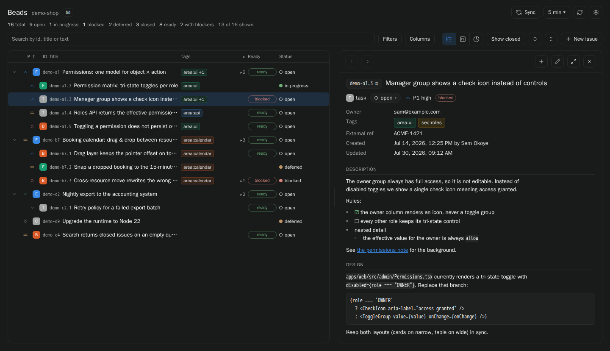

# Beads for Paseo

**English** · [Русский](README.ru.md)

A [Paseo](https://paseo.sh) plugin with the [beads](https://github.com/gastownhall/beads)
(`bd`) issue tree of the workspace you have open: the hierarchy on the left, a card
for the selected issue on the right with every property, text block and link, and
two more ways to read the same list, a board of status lanes and a set of charts.

**Reads issues, creates them and edits their properties.** The tree and the card
are read through `bd --readonly`; writes travel a separate path, through a closed
set of `bd` subcommands, and never mix with reads. The plugin cannot delete issues
and never creates a git commit.



<sub>Every screenshot in this repository is a test artefact, rendered by
`npm run preview` in the real Paseo web app on the synthetic fixture in
`tests/fixture/`. No real project is pictured.</sub>

## Highlights

- **A real tree.** Hierarchy by `parent` / `parent-child` links, virtualized, so a
  project of thousands of issues scrolls like a short one.
- **Columns, sorting and filters.** Toggleable columns, sorting that reorders
  siblings without ever taking a child out from under its parent, and
  multi-select filters for status, type, priority, readiness, creation date, tags
  and assignee.
- **Search that keeps the heavy text on the host.** IDs, titles and tags are
  searched in the panel as you type; descriptions, design, criteria and notes are
  searched by the daemon.
- **A board when the tree is not the question.** One lane per status, the same
  filters and search, and a card moved into another lane changes its status.
- **Charts when the question is "how many" or "how fast".** Breakdowns of exactly
  the filtered issues, the work over time (cumulative flow, pace, waiting and
  working time, predictability, cohorts), and a page per assignee and per author.
- **A card, not a dump.** Every property, Markdown text blocks, linked issues as
  sortable tables with a progress bar, and the comment thread. An issue key
  spelled out in the text is a link to that issue.
- **Write from the panel.** Create issues, edit their fields, change status, post
  comments. Status changes go through `bd close` / `bd reopen`, so `closed_at` and
  the close reason stay honest; set your name once in the plugin's settings page
  and comments are signed with it.
- **Sync in one button.** Reconciles `issues.jsonl` and the database both ways,
  never letting older data overwrite newer.
- **Watch the agents work.** A cheap change marker is polled, only the issues
  that changed are fetched, and they are highlighted without disturbing your
  selection, scroll or open branches.
- **Opens at once.** The daemon host keeps the last list of each project on disk
  and the app keeps it in memory, shared by every Beads tab and the explorer, so
  the tab draws the issues straight away, after a plugin reload too, and a quiet
  "Refreshing…" says when newer rows are on their way.
- **Works without a database too.** With only `issues.jsonl` the panel reads that
  and goes read-only.
- **Your work in the explorer.** A compact panel in Paseo's right sidebar: your
  issues in progress and ready to pick up, counts and a search; a click opens the
  issue in the tab.
- **A button in the workspace header** of every workspace with a `.beads`
  project: the tab, the board or the explorer in one click, also on a
  phone-sized window.
- **Russian and English**, light and dark; in a narrow tab or on a phone, the
  list and then the card in its place, with a way back.

More pictures: [the whole interface, screenshot by screenshot](docs/screenshots.md).

## Requirements

- **Paseo 0.15.4 or newer** (the daemon and the app you open it in).
- **[beads](https://github.com/gastownhall/beads) (`bd`) on the daemon host's
  `PATH`.** The plugin runs on the daemon, so `bd` has to be installed where the
  daemon runs, not where you read. Without a hydrated database the panel falls
  back to `.beads/issues.jsonl` and stays read-only; see
  [Two modes](docs/modes.md).
- **A `.beads` directory in the workspace or one of its parents**, the same rule
  `bd` itself follows.

## Install

```bash
paseo plugin install github:DrStannum/paseo-plugin-beads
# or, from a local checkout:
paseo plugin install /path/to/paseo-plugin-beads
```

The daemon builds the plugin and loads it; nothing else needs restarting. Then, in
a workspace, open the **Beads** tab from the **+** menu over the workspace's tabs,
or type **Open Beads** (or **Open Beads board**, **Open Beads in the explorer**) in
the Command Center, or use the Beads button in the workspace header. The compact
panel for the explorer is added from the explorer's own **+** menu. The plugin's
settings page sits under Paseo's **Settings**, next to the other plugins.

The same source, `github:DrStannum/paseo-plugin-beads`, can be pasted into
**Settings → Plugins → Plugin source** instead of running the command; add
`--ref v0.2.0` to the command to pin a release rather than follow `main`.

## Documentation

The full description lives in [`docs/`](docs/README.md):

| | |
|---|---|
| [What the panel does](docs/features.md) | Every part of the interface: the tab and how to open it, the explorer panel, the header button, tree, board, charts, columns, filters, card, comments, settings, editing, Sync, the narrow tab, platforms, languages |
| [Two modes: `bd` and `jsonl`](docs/modes.md) | Where the data comes from, and what the read-only fallback cannot do |
| [Screenshots](docs/screenshots.md) | The whole interface in both themes and both languages |
| [How reading works](docs/reading.md) | One call per snapshot, the copy on disk, deltas, the shared cache and one poll, the change marker, the 30-second RPC budget, the boundaries |
| [How writing works](docs/writing.md) | What can be changed, why no git commit is ever created, how Sync works |
| [Privacy and issue text](docs/privacy.md) | What leaves the host, what it keeps on disk, and what keeps issue text from becoming markup or log output |
| [Design notes](docs/design-notes.md) | The palette, and why no colour carries the message alone |
| [Development and tests](docs/development.md) | The suites, the screenshot harness, what each one needs |

## Contributing

Bug reports and patches are welcome. [CONTRIBUTING.md](CONTRIBUTING.md) has the
setup, how to run the tests, and the handful of invariants a change has to respect.

Found a security problem? Please report it privately, see
[SECURITY.md](SECURITY.md). Released versions are listed in
[CHANGELOG.md](CHANGELOG.md).

## Origin

This plugin is a port of
[cloudcli-plugin-beads](https://github.com/DrStannum/cloudcli-plugin-beads), the
same panel as a tab for CloudCLI UI. Its data logic, texts and tests are the
reference this port follows; the windows are Paseo's own (a tab of the workspace,
a panel in the explorer, the Command Center, the header button), and where the two
differ on purpose, the [changelog](CHANGELOG.md) says so.

## Related

- [beads](https://github.com/gastownhall/beads), the issue tracker this panel
  reads and writes.
- [Paseo](https://paseo.sh), the app the panel lives in.

## License

MIT © 2026 DrStannum, see [LICENSE](LICENSE).
