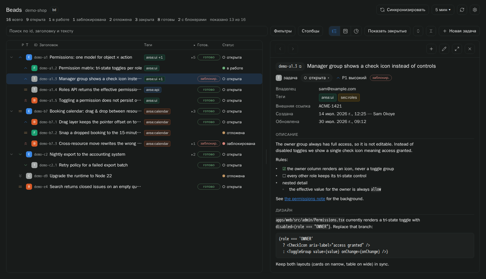

# Beads для Paseo

[English](README.md) · **Русский**

Плагин для [Paseo](https://paseo.sh) с деревом задач [beads](https://github.com/gastownhall/beads)
(`bd`) того воркспейса, который у вас открыт: иерархия слева, карточка
выбранной задачи справа — со всеми свойствами, текстовыми блоками и связями, — и ещё
два способа прочитать тот же список: доска с колонками по статусам и набор графиков.

**Читает задачи, создаёт их и правит свойства.** Дерево и карточка читаются через
`bd --readonly`; запись идёт отдельным путём, через закрытый набор подкоманд `bd`, и
никогда не смешивается с чтением. Удалять задачи плагин не умеет и никогда не делает
git-коммит.



<sub>Все скриншоты в этом репозитории — артефакты тестов: их снимает
`npm run preview` в настоящем веб-приложении Paseo на синтетической фикстуре из
`tests/fixture/`. Ни одного живого проекта на них нет.</sub>

## Коротко о главном

- **Настоящее дерево.** Иерархия по связям `parent` / `parent-child`,
  виртуализованная, так что проект из тысяч задач прокручивается так же легко, как
  короткий.
- **Колонки, сортировка и фильтры.** Включаемые колонки; сортировка переставляет
  соседей, но никогда не вынимает ребёнка из-под родителя; фильтры с множественным
  выбором по статусу, типу, приоритету, готовности, дате создания, тегам и
  исполнителю.
- **Поиск, который оставляет тяжёлый текст на хосте.** Идентификаторы, заголовки и
  теги ищутся в панели прямо по мере ввода; описания, дизайн, критерии и заметки
  ищет демон.
- **Доска, когда вопрос не про дерево.** Колонка на каждый статус, те же фильтры и
  поиск, а карточка, перенесённая в другую колонку, меняет статус.
- **Графики, когда вопрос «сколько» или «как быстро».** Разрезы ровно
  отфильтрованных задач, работа во времени (накопительный поток, темп, время
  ожидания и работы, предсказуемость, когорты) и страница на каждого исполнителя и
  каждого автора.
- **Карточка, а не дамп полей.** Все свойства, текстовые блоки в Markdown, связанные
  задачи в виде сортируемых таблиц с полосой прогресса и ветка комментариев. Ключ
  задачи, написанный в тексте, — ссылка на эту задачу.
- **Запись прямо из панели.** Создать задачу, поправить поля, сменить статус,
  написать комментарий. Смена статуса идёт через `bd close` / `bd reopen`, поэтому
  `closed_at` и причина закрытия остаются честными; задайте своё имя один раз на
  странице настроек плагина — и комментарии будут подписаны им.
- **Sync одной кнопкой.** Приводит `issues.jsonl` и базу в согласие в обе стороны,
  не давая старым данным затереть более свежие.
- **Видно, как работают агенты.** Панель опрашивает дешёвый маркер изменений и
  подсвечивает изменившееся, не сбивая ни выделение, ни прокрутку, ни раскрытые
  ветки.
- **Работает и без базы.** Если есть только `issues.jsonl`, панель читает его и
  переходит в режим только для чтения.
- **Ваша работа в боковой панели.** Компактная панель в правой боковой панели
  Paseo: ваши задачи в работе и готовые к работе, счётчики и поиск; нажатие
  открывает задачу во вкладке.
- **Русский и английский**, светлая и тёмная темы, одна колонка на узкой панели.

Больше картинок: [весь интерфейс, скриншот за скриншотом](docs/ru/screenshots.md).

## Что нужно

- **Paseo 0.15.4 или новее** (и демон, и приложение, в котором вы его открываете).
- **[beads](https://github.com/gastownhall/beads) (`bd`) в `PATH` хоста демона.**
  Плагин работает в демоне, поэтому `bd` должен быть установлен там, где запущен
  демон, а не там, где вы читаете. Без развёрнутой базы панель откатывается к
  `.beads/issues.jsonl` и остаётся только для чтения — см.
  [Два режима](docs/ru/modes.md).
- **Каталог `.beads` в воркспейсе или в одном из его родителей** — то же
  правило, которому следует сам `bd`.

## Установка

```bash
paseo plugin install https://github.com/DrStannum/paseo-plugin-beads.git
# или из локальной копии:
paseo plugin install /path/to/paseo-plugin-beads
```

Демон соберёт плагин и загрузит его; больше ничего перезапускать не нужно. Затем в
воркспейсе откройте **Beads** среди панелей воркспейса либо наберите **Открыть Beads**
(или **Открыть доску Beads**, **Открыть Beads в боковой панели**) в Command Center. Страница настроек
плагина находится в «Настройках» Paseo, рядом с другими плагинами.

Адрес репозитория выше — задуманный дом проекта; пока он там не опубликован,
ставьте из локальной копии.

## Документация

Полное описание лежит в [`docs/ru/`](docs/ru/README.md):

| | |
|---|---|
| [Что умеет панель](docs/ru/features.md) | Каждая часть интерфейса: дерево, доска, графики, колонки, фильтры, карточка, комментарии, настройки, редактирование, Sync, режим двух карточек, узкая вёрстка, платформы, языки |
| [Два режима: `bd` и `jsonl`](docs/ru/modes.md) | Откуда берутся данные и чего не может откат к режиму только для чтения |
| [Скриншоты](docs/ru/screenshots.md) | Весь интерфейс в обеих темах и на обоих языках |
| [Как устроено чтение](docs/ru/reading.md) | Один вызов на снапшот, маркер изменений, 30-секундный бюджет RPC, границы |
| [Как устроена запись](docs/ru/writing.md) | Что можно изменить, почему не возникает ни одного git-коммита, как работает Sync |
| [Приватность и текст задач](docs/ru/privacy.md) | Что покидает хост и что не даёт тексту задач стать разметкой или попасть в логи |
| [Заметки о дизайне](docs/ru/design-notes.md) | Палитра и почему ни один цвет не несёт сообщение в одиночку |
| [Разработка и тесты](docs/ru/development.md) | Наборы тестов, стенд для скриншотов, что нужно каждому |

## Как участвовать

Сообщения об ошибках и патчи приветствуются. В [CONTRIBUTING.ru.md](CONTRIBUTING.ru.md)
описано, как всё поднять, как гонять тесты и какие несколько инвариантов изменение
обязано соблюсти.

Нашли проблему с безопасностью? Сообщите о ней приватно — см.
[SECURITY.ru.md](SECURITY.ru.md). Выпущенные версии перечислены в
[CHANGELOG.ru.md](CHANGELOG.ru.md).

## Происхождение

Этот плагин — порт
[cloudcli-plugin-beads](https://github.com/DrStannum/cloudcli-plugin-beads), той же
панели в виде вкладки для CloudCLI UI. Её поведение, тексты, тесты и документация —
эталон, которому следует порт; там, где они намеренно расходятся, об этом сказано в
[истории изменений](CHANGELOG.ru.md).

## Рядом

- [beads](https://github.com/gastownhall/beads) — трекер задач, который эта панель
  читает и пишет.
- [Paseo](https://paseo.sh) — приложение, в котором живёт панель.

## Лицензия

MIT © 2026 DrStannum — см. [LICENSE](LICENSE).
