# What the panel does

**English** · [Русский](ru/features.md)

Every part of the interface, in the order you meet it: where the panel lives, the
tree, the board, the charts, the columns, the filters, the card, editing, syncing.

**Where it lives.** Beads is a tab of the workspace. Open it from the **+** menu
over the workspace's tabs, from the Command Center (**Open Beads** opens the tab,
or brings up the one already open; **Open Beads board** does the same and switches
it to the board), or from the Beads button in the workspace header (below). It
shows the issues of whichever `.beads` project the workspace directory sits in
(the workspace directory itself or the nearest parent holding a `.beads`, the rule
`bd` itself follows). The daemon resolves that directory from the workspace, so
the panel never sends a path of its own.

The tab is an ordinary Paseo tab: it can be moved, split beside another one or
closed, and the **+** menu always adds a new Beads tab, even when one is open.
Every Beads tab of a workspace shows the same data, fetched once, and keeps a
state of its own. That state (the open branches, the selection, the filters, the
columns, the sort, the view, the card width) is what the tab remembers between
visits; Paseo stores it with the tab, on the device, so each tab and each
workspace keeps its own. The panel itself opens no second window, overlay or
floating card: when two things should sit side by side, they are two tabs.

**The header button.** A workspace that has a `.beads` project gets a Beads button
in its header, a menu: **Open Beads**, **Open Beads board**, **Open Beads in the
explorer**. A workspace without one gets no button. In a phone-sized window Paseo
folds plugin buttons into the header's **⋯** sheet (Beads is there, under
**Workspace actions**), and the explorer item is left out: there is no explorer
there, and the Command Center does not open, so this is the quick way in. The
plugin checks which workspaces have a project (a few file checks on the daemon,
no `bd`) when it starts, when the workspaces change, and every 30 seconds, so a
`bd init` in an open workspace brings the button within half a minute.

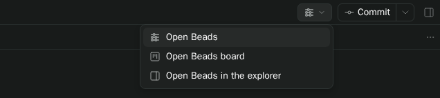

**In the explorer.** Paseo's right sidebar (the explorer) gets its own Beads
panel, not a smaller copy of the tab: your work at a glance. Add it from the
explorer's **+** menu, or type **Open Beads in the explorer** in the Command
Center (on a phone-sized window there is no explorer, and that opens the tab
instead). It lists the issues assigned to you, in two foldable sections: **In
progress**, then **Ready** (open, every blocker closed, the same rule as the
tab's "ready" and `bd ready`), the most urgent first. Three counts sit on top (in
progress, ready, and open at all, blocked and deferred ones included), and a
search box narrows both lists by ID and title, plus the daemon's full-text hits
from two characters on. Picking an issue opens it in the Beads tab, with its
branch expanded, and the tab is opened if it was not. Who "you" are is the name
in the plugin's settings page, the one **Assign to me** writes; without it the
panel says so and offers the way there. The explorer reads the same list as the
tab, from the same cache, and joins the same change check, so with the tab open
it asks the daemon for nothing more. It fits the sidebar's widths, from Paseo's
240 px minimum up.

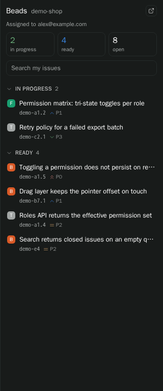

**The tree.** Hierarchy by `parent` / `parent-child` links (not by parsing the
dotted notation in IDs, which is cosmetic). A node carries a priority icon, the
type, ID, title, status, child count, a `ready`/`blocked` marker and the first
tag. The priority icon (a Tracker-style chevron, colour and direction set by the
level) is the leftmost column; hovering it on the web gets the level spelled out
("P0 — critical"). There is an expand/collapse-all. The list is virtualized: only
the rows on screen are rendered, so a project of thousands of issues scrolls like
a short one.

**The board.** The segmented switch in the toolbar moves between three ways of
reading the same list: the tree, a board with one lane per status, and the
charts. The board is flat (no hierarchy, because that is what the tree is for and
what the card shows), and it takes the same filters, the same search and the same
sort as the tree, so switching does not change *which* issues you are looking at,
only how they are laid out. There is a lane for every status the project actually
uses, in bd's own order, with any custom status at the end; `closed` appears only
when closed issues are shown. A lane a filter empties stays on screen, and stays a
drop target, instead of making the board rearrange itself as you type. The number
in a lane header counts every issue in that lane, even when the lane is cut short:
past 50 cards a lane ends with an "N more" button rather than growing without
limit. A card carries the priority icon, the type glyph, the ID, the title, the
first tag, `ready`/`blocked`, the assignee, the child count and the comment count;
pressing it opens the issue card beside the board. With nothing selected the board
takes the whole width.

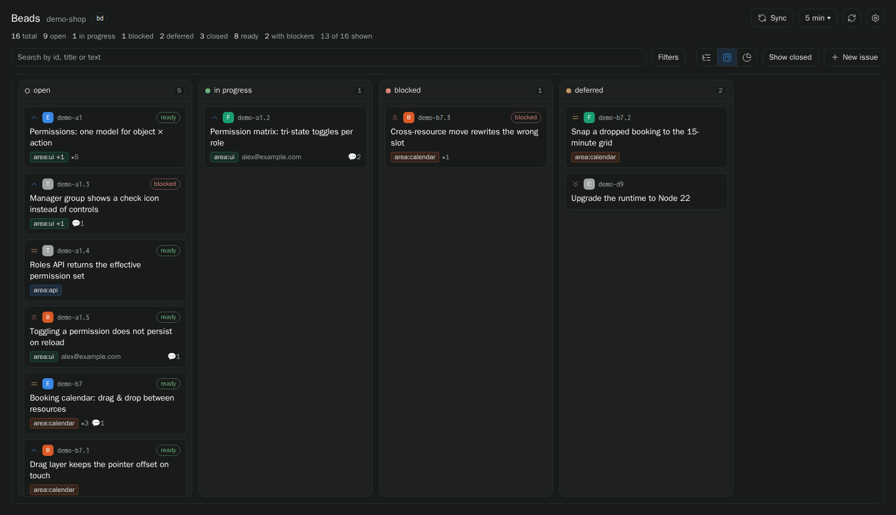

**Moving a card changes the status.** On the web and in the desktop app, drag a
card into another lane: the lane under the pointer lights up, and dropping it
there writes the new status. It is the same one-field write the card's own status
control performs, so a move into `closed` still goes through `bd close` and
`closed_at` stays honest. Dropping a card back into its own lane, or outside the
board, does nothing, and Esc during the drag cancels it. A short press without
movement still opens the card. While a write is in flight the card says so, on
the board and on the open issue card alike; if bd refuses the change, the card
stays where it was and the reason appears on it. On a phone or tablet there is no
drag: a long press on a card opens a "Move to" menu with the other lanes. In jsonl
mode there is nothing to write to, so cards do not move at all and the tooltip
says why.

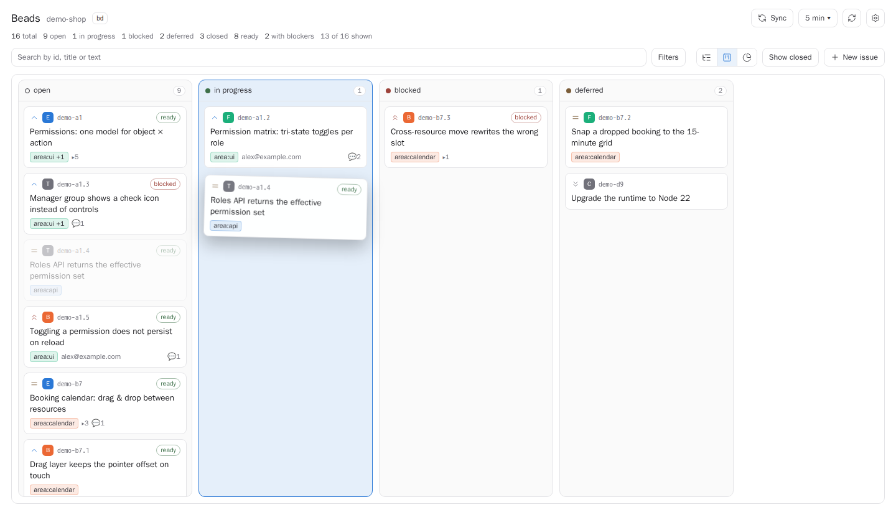

**Charts.** The third position of the switch turns the list into charts of
exactly the issues the tree and board would show. There are four readings,
switched at the top of the pane: how the issues divide up right now
(Breakdowns), how the work has moved over a period (Over time), who is carrying
it (Assignees) and who raises it (Authors).

The breakdowns are six cuts: by assignee, status, priority, readiness, type and
tag. They read the same selection as the rest of the panel (the same filters, the
same search, the same "Show closed"), so the bars move the moment a filter does,
and the count on every bar (except tags) adds up to the "shown" number in the
header. Each breakdown is a card of horizontal bars, one per value, scaled to that
breakdown's own tallest bar; a value is never dropped for being missing: issues
with no assignee land in their own "unassigned" bar, tagless ones in "no tags".
Tags are the one exception to the sum rule: an issue with three tags is counted in
all three bars, and the card says so in a caption. Assignees and tags are ranked
by count and capped at eight named bars; the rest collapse into an honest "other"
bar. The colours are the ones the tree and the board already use. Nothing here
writes to an issue.

A bar is also a way in. Pressing one narrows the panel to that bucket (press an
assignee's bar and the panel is filtered to that assignee), and every other
breakdown, the header counts and the list are recounted with it. Pressing the same
bar again clears the filter, and so does the chip it raises over the list. The
bars that stand for a group of values rather than one ("other", "unassigned", "no
tags", an unset priority) are deliberately not buttons, and their tooltip says so.

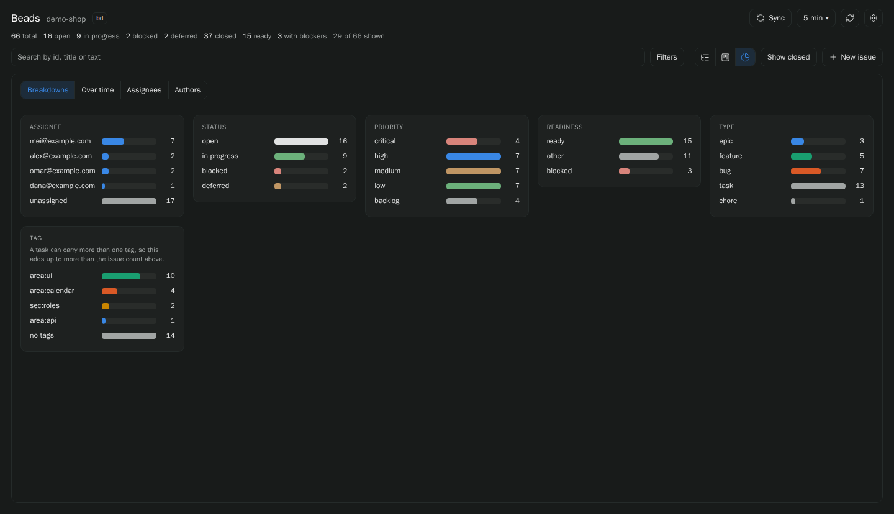

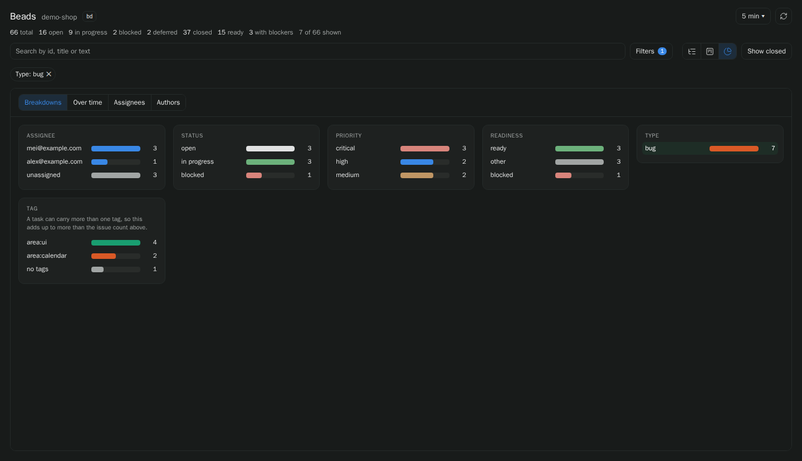

**Over time.** The second reading answers whether the work is moving. A period
(30, 90 or 180 days, or the whole history) picks how far back to count; a step
(auto, day, week or month) picks how wide one bucket is. On auto the step follows
the period; pinning it is how "how many did we close each week" gets asked of a
span the period alone would have drawn differently. The step applies to every
chart on the page at once, and every chart shares one time axis, so a date stands
at the same place on all of them. Six figures sit on top: opened, closed, what the
backlog did over the period, how much is open and in progress right now, and the
median time an issue took to close. Then:

- **When the backlog clears**, the one figure about the future, labelled an
  estimate: what is open now divided by how much faster the closing ran than the
  raising. Where the backlog grew there is no date to give, and the row says so.
- **Pace**: two lines, work arriving and work being finished, as a rolling
  average over a window taken from the step (a week of days, a month of weeks, a
  quarter of months), named in the caption. Hovering a step reports its real
  counts; the line is the trend.
- **Opened and closed**, step by step, as paired bars.
- **Work over time**, the cumulative flow: every issue that existed at each step
  in one of three states (waiting, in progress, done) stacked from the baseline
  up. A stack that grows faster than its green base is a backlog outrunning the
  team.
- **Waiting and working**: the median time spent in the queue against the median
  time spent being done.
- **Predictability**: the median close time against its 85th percentile; a narrow
  band means a date can be promised.
- **Age of the open backlog**, **work in progress**, and **bugs, arriving and
  leaving**: the share of bugs in what is raised against what is closed.
- **What became of each step's intake**: the issues raised in one step followed as
  a cohort, closed within one step, two, four, and by now.

On the web every mark answers the pointer: hovering says where it is and how many
more or fewer than the step before, while the rest of that chart dims.

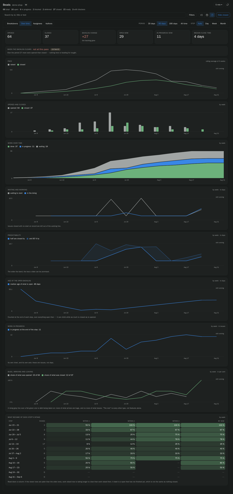

**Assignees.** A row per assignee, ranked by what they closed over the period,
with the count drawn as a bar and a sparkline beside it showing whether that work
arrived steadily or in one burst. In progress, waiting and total are the state
right now; closed is the period's work. Any column sorts. Issues with nobody on
them get their own row, always last. Opening a name gives that person's page:
their figures, their run of closings, their closing pace, the status, priority
and type breakdowns of their issues alone, and what they are holding, oldest
first. Pressing one of those issues leaves for the tree and opens its card.

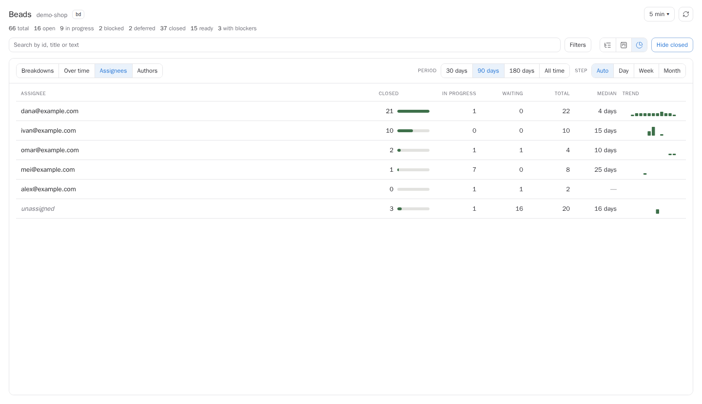

**Authors.** Raising work and finishing it are different roles kept in different
fields, so they get different readings: a row per author with what they raised
over the period, how much of it has since been closed and how much is still open,
and a page per author with the same figures, what they raised step by step, that
raising as a smoothed pace, and the kinds of work they tend to raise. Beads keeps
the author in a field of its own, so these names need not match any assignee, and
the table says so underneath.

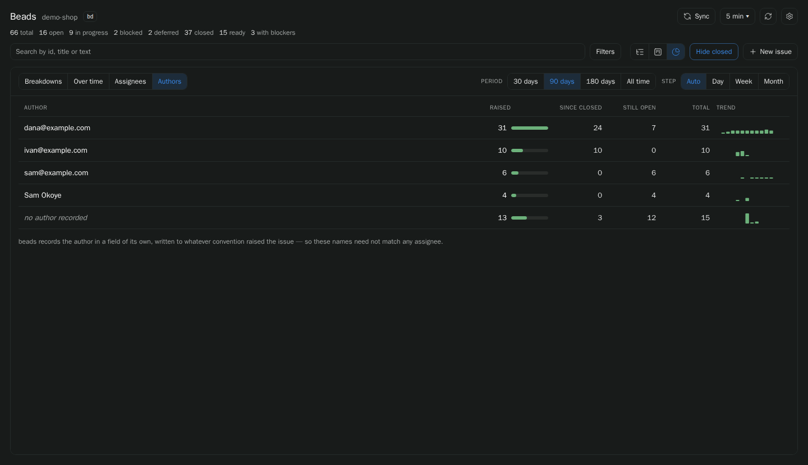

**What the time readings cannot know.** Beads records three moments per issue
(created, started, closed) and no history of status changes, so everything here is
reconstructed from those three. A reopened issue shows only its latest close. An
issue whose status says it moved but which carries no timestamp is counted from
when it was last touched. An issue with no creation date is left out of the
series, and the chart says how many. **The assignee is the current one**: an issue
closed six months ago counts for whoever holds it today. And the readings obey
every filter, "Show closed" included: with closed issues hidden (the default)
nothing counts as done, and the page says so with the switch to hand.

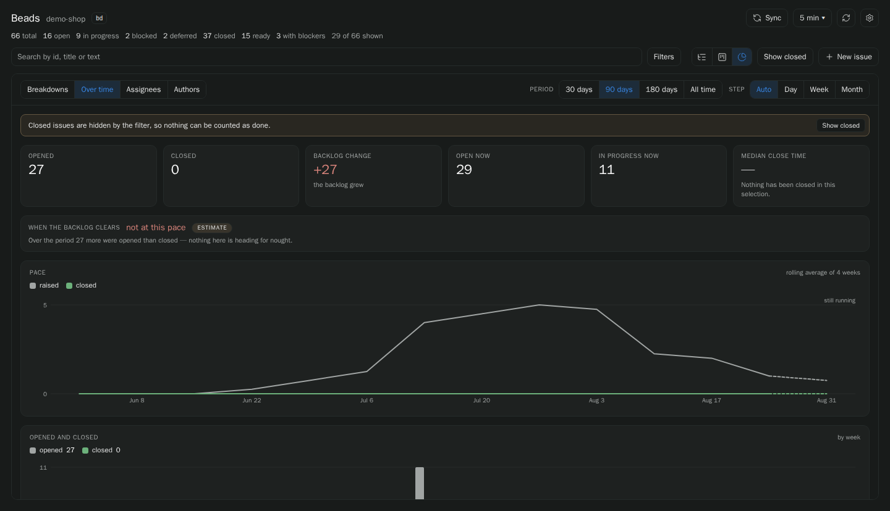

**Columns and sorting.** The "Columns" button turns any list column on and off:
priority, type, ID, tags, children, readiness, status, assignee, created and
updated dates, comments (the last four off by default). The header is clickable:
the first click sorts ascending, the second descending, the third restores the
natural order by ID. **Sorting reorders siblings, it does not break the
hierarchy**: a child stays under its parent under any sort, and ties are broken by
ID, so the order is stable across refreshes. When the columns do not fit, the list
scrolls sideways together with its header rather than squeezing titles into an
ellipsis.

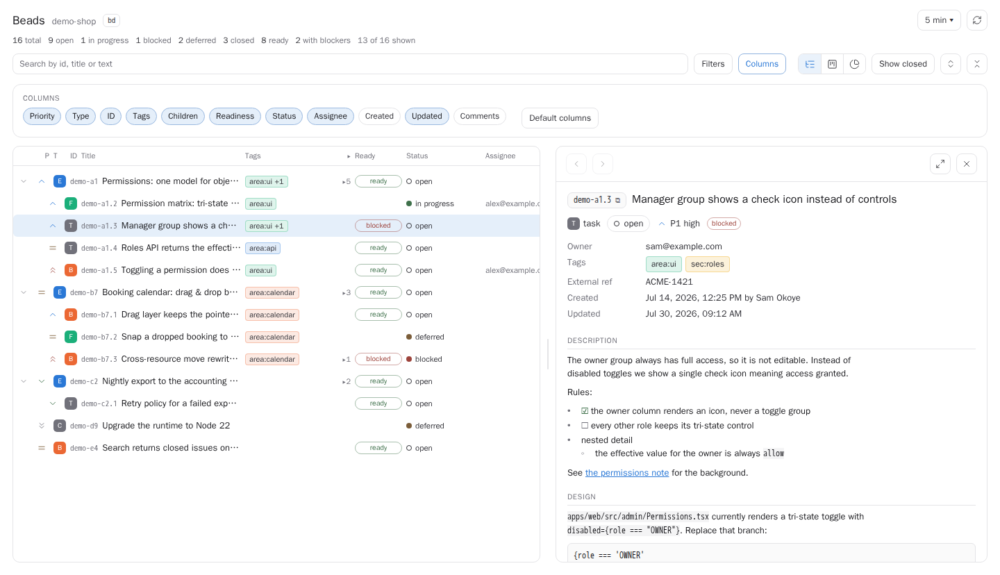

**In a narrow tab** (the tab's own width below 900 px, as when it is split
beside another, or whenever Paseo reports a compact layout, as it does in a
phone-sized window) the panel becomes one screen at a time: first the list, then a
picked issue's card in its place across the whole tab, with a button back to the
tree or the board. While the card is up, the toolbar (search, filters, the view
switch) steps aside; the title and the counts stay. If you followed links from
that card, the first button is **Back** through them instead, and the cross
returns to the list at once. Back at the list, the issue is still selected and the
list is scrolled where it was, sideways on the board too. The board narrows its
lanes so one and a hint of the next fit, and is swiped sideways. The splitter is
hidden there.

**Card width.** On the web and in the desktop app there is a splitter between the
list and the card: drag it to give the card more room; a double click restores the
default proportions. The list always keeps at least 340 px.

**Closed issues are hidden by default.** The toolbar button names the action, not
the state: "Show closed" or "Hide closed". If a visible issue's parent is hidden
by a filter, the issue does not disappear: it rises under the nearest visible
ancestor (or to the top level) and is marked with a `↳` arrow.

**Search and filters.** Search is live. Over IDs, titles and tags it runs in the
panel as you type; descriptions, design, criteria and notes are searched by the
daemon (`beads.search`), so the heavy texts never travel to the client. Branches
leading to a hit expand automatically. A query that spells out an issue key whole
answers with that issue alone: keys nest (`demo-a1` is a prefix of `demo-a1.2`)
and get quoted in other issues, so a plain substring pass would bury the one issue
asked for.

Filters sit in a panel with counts: status, type, priority and readiness
(ready / blocked), all multi-select. "Created" is a time window (last day, 7, 30
or 90 days). Tags are a searchable multi-select with counts, and several tags work
as OR. Assignee is a list built from the assignees actually present; it matches
that field alone, not the owner. Active filters sit as chips under the toolbar and
come off one at a time or all at once; pressing a tag in the card adds it to the
same filter.

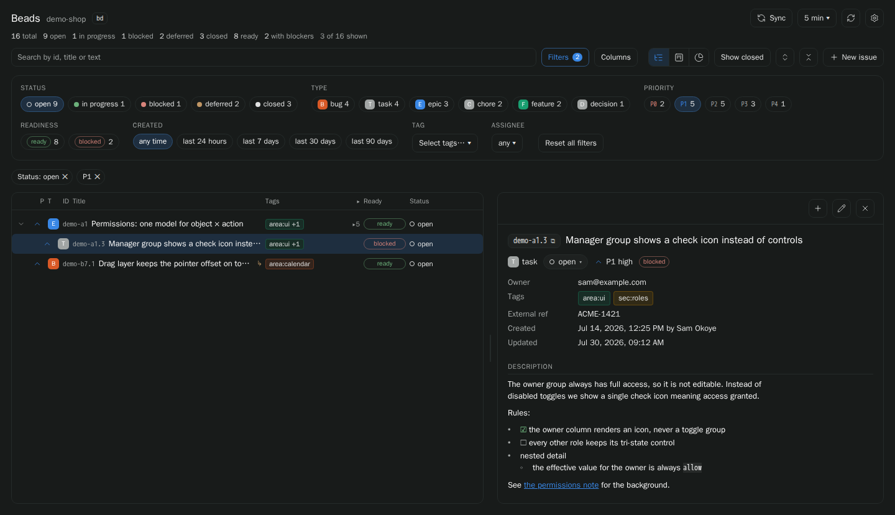

**The card.** The key sits to the left of the title (and copies on press), then
type, status, priority (the icon plus its P-level and name, e.g. "P1 high"),
owner and assignee, tags as coloured chips, `external_ref`, every date and the
close reason. The `description` / `design` / `acceptance_criteria` / `notes` text
blocks render as Markdown, through the plugin's own renderer that builds
components rather than markup.

**An issue key written in the text is a link.** A key spelled out in prose inside
any of the text blocks or a comment becomes pressable, but only when the project
actually holds that issue, and never inside a code span, a code block or an
existing link. Pressing one opens that issue: it expands the branch in the tree,
scrolls to the row and, if the issue is closed while closed issues are hidden,
turns "Show closed" on.

**The status is a control, not a caption.** Pressing it opens the list of statuses
and picking one writes it straight away, through the same `bd close` / `bd reopen`
path the edit form takes. In jsonl mode it stays a caption.

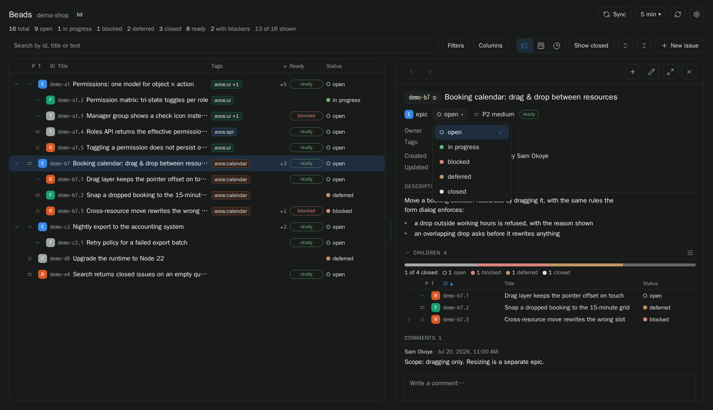

**Linked issues are small tables.** Each link type (parent, children, blockers,
what it blocks, `discovered-from` and anything else beads adds) gets a sortable
header, a column picker, and for children a progress bar over their statuses,
keyed by a legend in the bar's own colours. The children block is a tree: a child
with children of its own gets a twisty, folded until asked. Each block folds away
from its header and keeps its count. Following a link expands the branch in the
tree, scrolls to the issue and highlights it; **Back** in the card header then
returns to the card the link was followed from. It shows only when there is one
to return to, and picking an issue in the tree or on the board starts over. To
read two cards side by side, open a second Beads tab from the "+" menu and split
it beside the first: tabs and splits belong to Paseo, not to the panel.

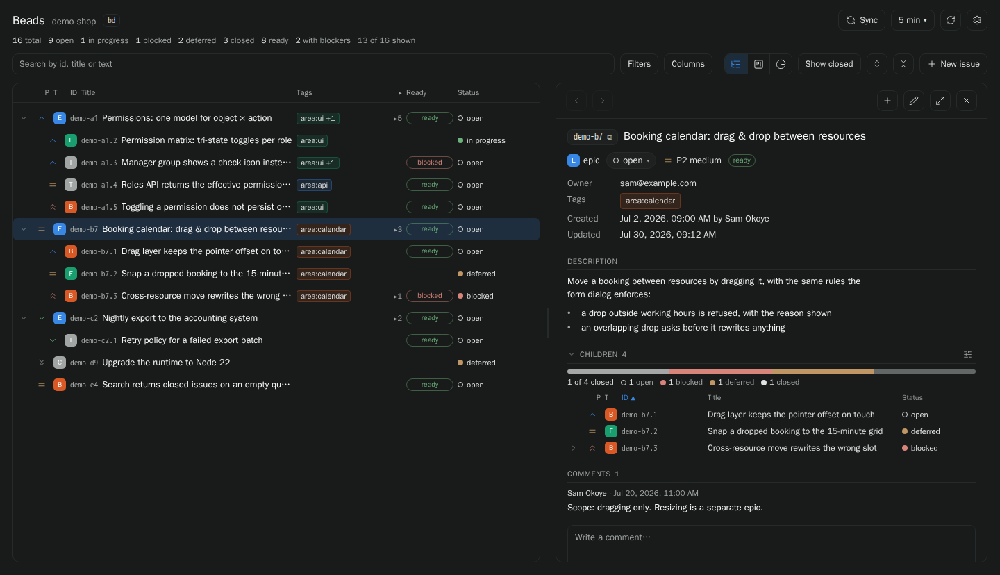

**Comments** are append-only, because beads is: `bd` offers `bd comment` (add) and
`bd comments` (list) and nothing to edit or delete one. The panel therefore reads
and writes them and does not pretend to edit them. They render as Markdown and
sort by date either way. Under the thread there is a box to write a new one:
Ctrl+Enter (Cmd+Enter on a Mac) or the button posts it, and the thread grows
without a refresh. A draft stays in the box while you look at other issues, for
as long as the panel is open. The hint under the box says whose name the comment
will carry.

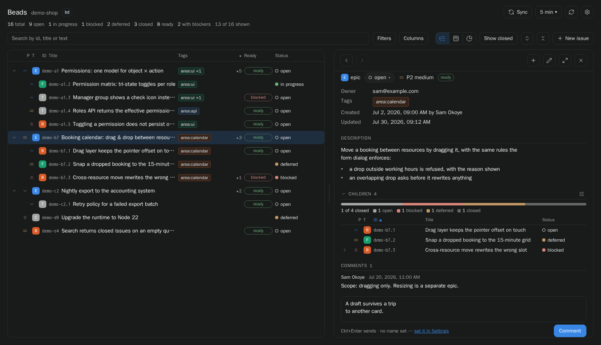

**The settings page.** The gear in the panel header opens the plugin's page in
Paseo's **Settings**. It has two settings, kept on the daemon host and shared by
every client of it (never written into the project):

- **Your name.** Two things use it. The **Assign to me** button next to the
  assignee in the card writes the field straight away; it appears only when a
  name is set and the issue is not already yours. And comment authorship: with a name set a
  comment is recorded as coming from it, without one bd records the plugin's own
  identity, and the hint under the comment box says which, with a link to the
  settings page when there is no name yet.
- **Refresh interval**: 10, 30 or 60 seconds, 5 or 15 minutes (5 minutes by
  default). The same choice sits in the panel header.

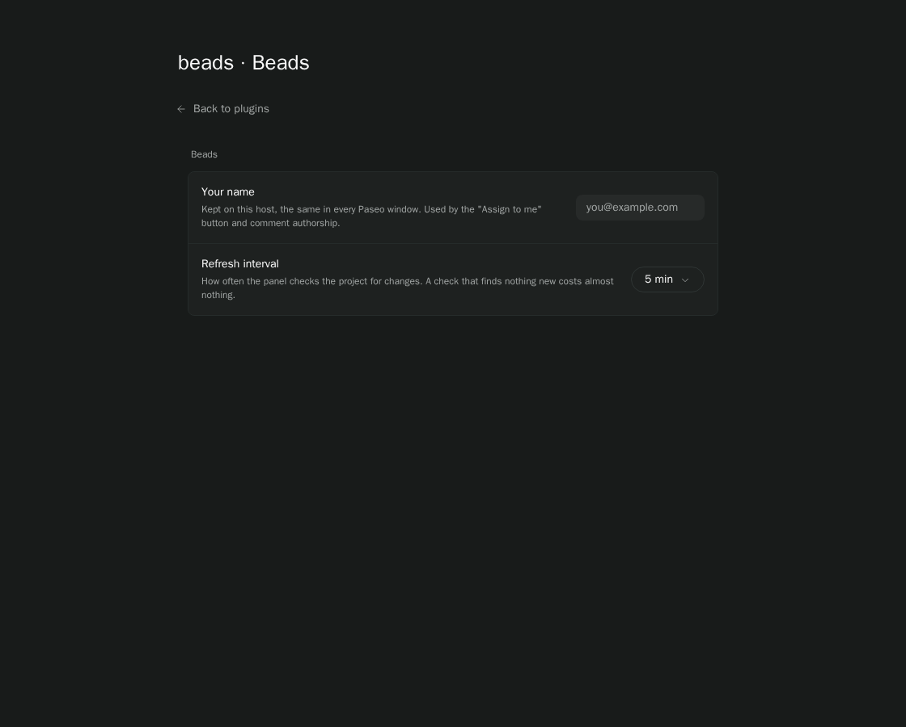

**Editing.** The pencil button in the card header opens a form: title, type,
status, priority, assignee, tags, parent, `external_ref` and the four text blocks.
Only the fields you actually changed are sent: `bd update --notes` overwrites the
notes wholesale, so untouched fields must not be transmitted. Save stays disabled
until something changes; closing the form with something typed in it asks first.
A write error stays in the form as text, and nothing typed is lost. Type, status
and priority are pickers carrying the same icons the list uses; assignee, tags and
parent suggest what the project already contains and take free text.

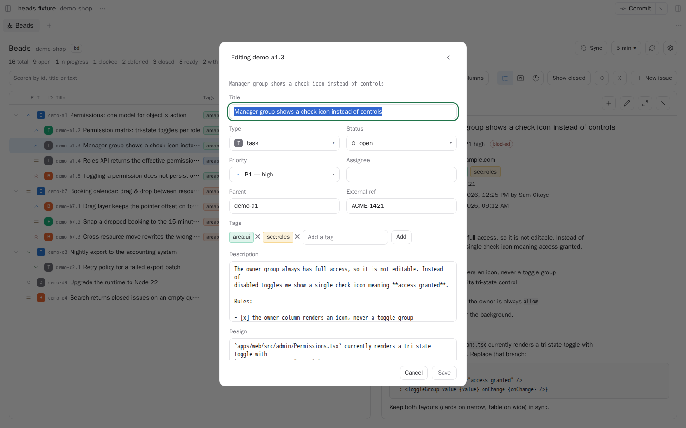

**Creating.** The **New issue** button in the toolbar opens the same form empty;
the **+** in a card header opens it with that issue already filled in as the
parent, which is how a subtask is made. Once bd answers, the panel selects the
issue it created and reveals it in the tree. For what can be changed and how the
write path is built, see [How writing works](writing.md).

**Sync.** The **Sync** button in the header puts `issues.jsonl` and the database
back in step, both ways, never letting older data overwrite newer; the badge next
to it says what is running and, when it is done, what came in from the file. The
details are in
[How writing works](writing.md#sync-putting-the-file-and-the-database-back-in-step).

`ready` carries the same meaning as `bd ready`: the issue is open and all its
blockers are closed. It is computed from the snapshot without a separate call,
and the tests check it against a real `bd ready`.

**Auto-refresh.** On the chosen interval the panel asks the daemon for a cheap
change marker and fetches the tree again only if it moved, and then only the
issues that changed; polling pauses while the app is in the background. However
many Beads tabs and explorer panels show a workspace, the check runs once for it.
Changed issues are highlighted briefly, so you can watch the agents work. A
refresh does not disturb the selection, the expanded branches, the scroll position
or where you are in the card.

**When a refresh fails.** The list on screen is never wiped by a failed refresh.
The rows stay, and a quiet strip under the counts says "Data may be out of date"
and why, in words ("beads is not set up in this project", "bd took too long to
answer"), with the raw code in its tooltip, and offers **Retry**. It goes away by
itself after the next good answer. While refreshes keep failing, polling backs
off, doubling the wait up to 5 minutes. A card that could not be reloaded stays
open marked "May be out of date". A workspace that has never loaded shows its
problem as an empty state with a hint and a **Retry** button.

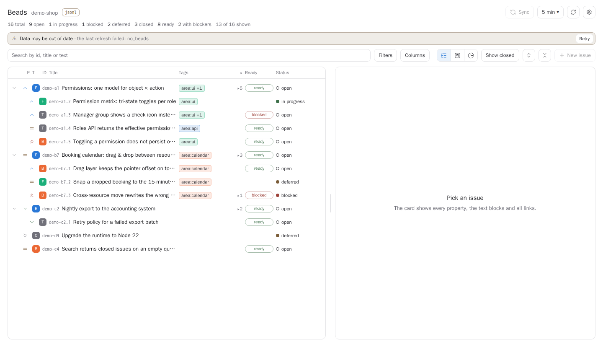

**Coming back is instant.** The app keeps the last good list of up to eight
workspaces, and the cards opened in them, in memory for as long as it is open, one
copy for every Beads tab and explorer panel of the host, so reopening the tab,
adding a second one or switching back to a workspace draws the list at once and
checks for changes in the background. The daemon host also keeps the last list of
each project on disk, so after a plugin reload or a daemon restart the tab draws
the issues from that copy straight away while `bd` is asked behind it. While newer rows are on their way, a quiet **Refreshing…** sits by the
title (only once a refresh has taken longer than a moment); when they arrive they
replace the old ones in place, and the selection, the open branches, the scroll
and the open card stay where they were. On the device nothing of the issues is
stored, because issue text can carry secrets; what the host keeps, where, and how
to remove it is in [Privacy and issue text](privacy.md), how the copies are kept
fresh in [How reading works](reading.md).

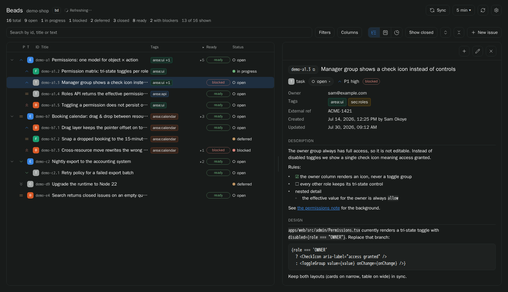

## Platforms

The panel is written once for every Paseo client, and the clients differ in what
they can do:

- **Web and the desktop app (Electron)**: everything above. Charts are
  interactive (hover readouts, dimming), tooltips show on hover, the board drags,
  the splitter drags, menus answer the keyboard (arrows, Enter, Esc).
- **iOS and Android**: the same panel; on a phone it is the narrow tab, one
  screen at a time, and there is no explorer (the header button's sheet is the
  quick way in). Charts are drawn as static
  pictures (no hover readout), there are no tooltips, the board has no drag and
  changes a status through a long-press "Move to" menu, and the card width is
  fixed. **These builds have not been tried on a device yet**: the native paths
  are type-checked, not tested by hand, so expect rough edges and please report
  them.

## Language

The interface is Russian and English. The language follows the Paseo app's own
setting and switches with it, no reload needed; any other app language renders
in English.

---

[← Documentation index](README.md) · [Project README](../README.md)
