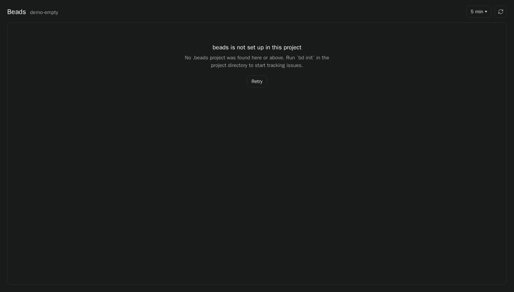
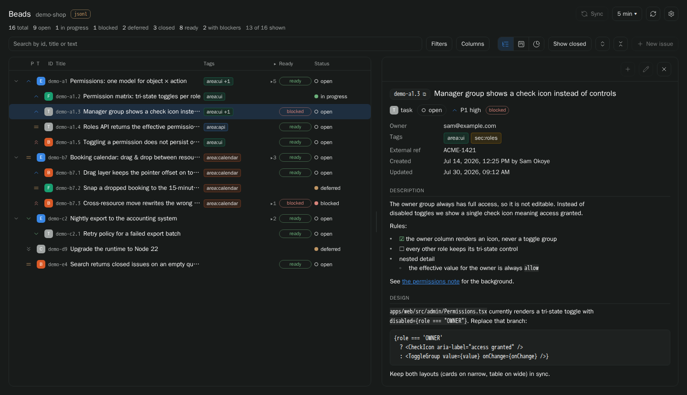

# Two modes: `bd` and `jsonl`

**English** · [Русский](ru/modes.md)

How the plugin decides where to read a project from, and what it can and cannot do in each mode.

Beads keeps its data in `<project>/.beads/`. Projects come in two states and the
plugin supports both. The mode shows as a badge next to the project name in the
panel header.

| Badge | When | Where the data comes from |
|---|---|---|
| `bd` | the database is hydrated | `bd --readonly --json list --all -n 0` |
| `jsonl` | no database, only the export | `.beads/issues.jsonl`, parsed line by line |

The mode is decided not by the presence of a directory but by fact: the CLI is
tried first, and if `bd` answers "no beads database found" the plugin falls back to
jsonl. That way it does not depend on beads' internals.

The fallback is for projects that have no database, not for a database that
failed once. A project that has already answered from `bd` and then gets a
non-zero exit (a locked database, say) stays in `bd` mode: the panel keeps showing
the last good copy under a "Data may be out of date" strip, and the error is
reported as `bd_failed`; see [How reading works](reading.md).

**What jsonl mode lacks.** The export is poorer than the CLI's answer, and the
interface degrades quietly: tags, `design`, `acceptance_criteria`, comment bodies
(only their count survives) and `external_ref` stay empty. Writing (edits, new
issues, comments, status changes, moving board cards) needs the database, so
those controls are disabled here with the reason in the tooltip, and the daemon
refuses them with `read_only_mode` even if asked directly. The parent does not
arrive as its own field in this mode; it is derived from the `parent-child` link,
so the tree still assembles in full.

The dates and the assignee do survive the export (`created_at`, `started_at`,
`closed_at` and `assignee`), so the charts' time and people readings work here as
they do in `bd` mode.

**`bd` has to be on the daemon host.** The plugin runs inside the Paseo daemon, so
`bd` is looked up on the `PATH` of the daemon's process (and, failing that, in
`/usr/local/bin` and `/usr/bin`). Without it a project with a database cannot be
read, and the panel says "bd was not found" with a hint.

If no `.beads` is found in the workspace directory or anywhere above it, the panel
shows an empty state with a hint (`bd init`) rather than an error.

---

[← Documentation index](README.md) · [Project README](../README.md)
