# Что умеет панель

[English](../features.md) · **Русский**

Каждая часть интерфейса в том порядке, в каком вы с ней встречаетесь: где живёт
панель, дерево, доска, графики, колонки, фильтры, карточка, редактирование,
синхронизация.

**Где она живёт.** Beads — вкладка рабочего пространства. Её открывают из меню
**+** над вкладками рабочего пространства, из Command Center (**Открыть Beads**
открывает вкладку или выводит на передний план уже открытую; **Открыть доску
Beads** делает то же и переключает её на доску) или кнопкой Beads в шапке рабочего
пространства (о ней ниже). Она показывает задачи того проекта `.beads`, в котором
лежит каталог рабочего пространства (сам этот каталог или ближайший родитель, где
есть `.beads`, — то же правило, которому следует сам `bd`). Каталог по рабочему
пространству определяет демон, поэтому панель никогда не присылает собственный
путь.

Вкладка — обычная вкладка Paseo: её можно перенести, поставить в сплит рядом с
другой или закрыть, а меню **+** всегда добавляет новую вкладку Beads, даже если
одна уже открыта. Все вкладки Beads одного рабочего пространства показывают одни и
те же данные, полученные один раз, а состояние у каждой своё. Это состояние
(раскрытые ветки, выбор, фильтры, колонки, сортировка, вид, ширина карточки) — то,
что вкладка помнит между заходами; Paseo хранит его вместе с вкладкой, на
устройстве, так что у каждой вкладки и каждого рабочего пространства оно своё.
Сама панель не открывает ни второго окна, ни оверлея, ни плавающей карточки: если
двум вещам нужно стоять рядом, это две вкладки.

**Кнопка в шапке.** У рабочего пространства с проектом `.beads` в шапке
появляется кнопка Beads — меню: **Открыть Beads**, **Открыть доску Beads**, **Открыть Beads в боковой
панели**. Рабочее пространство без проекта кнопки не получает. В окне размером с телефон Paseo
убирает кнопки плагинов в лист **⋯** шапки (Beads там, в разделе **Действия с
рабочим пространством**), а пункта боковой панели нет: боковой панели там нет, и Command
Center не открывается, так что это быстрый путь к вкладке. Какие рабочие
пространства с проектом, плагин проверяет (несколько проверок файлов на демоне, без `bd`) при
запуске, при изменении списка рабочих пространств и раз в 30 секунд, так что после
`bd init` в открытом рабочем пространстве кнопка появится в течение полуминуты.

**В боковой панели.** В правой боковой панели Paseo (explorer) у Beads своя
панель, а не уменьшенная копия вкладки: ваша работа одним взглядом. Добавьте её из
меню **+** боковой панели или наберите **Открыть Beads в боковой панели** в
Command Center (в окне размером с телефон боковой панели нет, и тогда откроется
вкладка). В ней задачи, назначенные на вас, в двух сворачиваемых разделах: **В
работе** и **Готовы к работе** (открыта, все блокеры закрыты — то же правило, что
у отметки «готово» во вкладке и у `bd ready`), самые срочные сверху. Сверху три
счётчика (в работе, готовы и вообще открыты, включая заблокированные и
отложенные) и поле поиска: оно сужает оба списка по ID и заголовку, а с двух
символов добавляет полнотекстовые совпадения демона. Нажатие на задачу открывает
её во вкладке Beads с раскрытой веткой, а саму вкладку — если она не была
открыта. Кто такие «вы» — это имя на странице настроек плагина, то самое, которое
пишет **Назначить меня**; если его нет, панель так и говорит и ведёт туда.
Боковая панель читает тот же список, что и вкладка, из того же кеша и
подключается к той же проверке изменений, так что при открытой вкладке ничего
лишнего у демона не просит. Она помещается в любую ширину боковой панели, от
минимальных для Paseo 240 px.

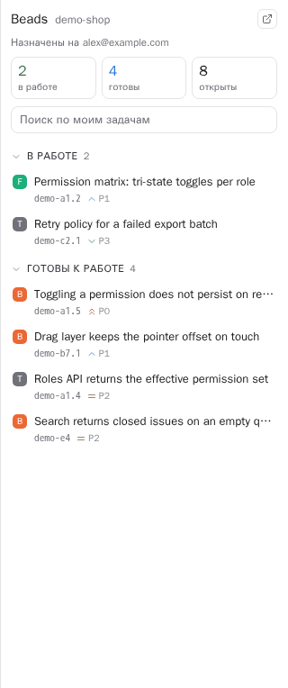

**Дерево.** Иерархия по связям `parent` / `parent-child` (а не разбором точечной
нотации в идентификаторах — она косметическая). Узел несёт иконку приоритета,
тип, идентификатор, заголовок, статус, число детей, метку `ready`/`blocked` и
первый тег. Иконка приоритета — стрелка в стиле Трекера, цвет и направление
которой зависят от уровня, — стоит самой левой колонкой; при наведении на web
уровень читается словами («P0 — критический»). Есть раскрыть/свернуть всё. Список
виртуализован: отрисовываются только строки, видные на экране, поэтому проект из
тысяч задач прокручивается так же, как короткий.

**Доска.** Сегментированный переключатель на панели инструментов переключает три
способа читать один и тот же список: дерево, доску, где на каждый статус
приходится своя колонка, и графики. Доска плоская — иерархии в ней нет, потому что
для иерархии есть дерево и карточка, — и живёт по тем же фильтрам, поиску и
сортировке, что дерево: переключение меняет не то, *какие* задачи вы видите, а
только раскладку. Колонка есть у каждого статуса, который в проекте действительно
встречается, в порядке самого bd, а кастомный статус получает колонку в конце;
`closed` появляется только при включённом показе закрытых. Колонку, которую фильтр
опустошил, доска оставляет на экране, и она остаётся мишенью для перетаскивания,
вместо того чтобы перестраиваться прямо под руками. Число в шапке колонки считает
все задачи в ней, даже если колонка подрезана: после 50 карточек внизу появляется
кнопка «ещё N», а не бесконечный список. На карточке — иконка приоритета, глиф
типа, идентификатор, заголовок, первый тег, `ready`/`blocked`, исполнитель, число
детей и число комментариев; нажатие открывает карточку задачи рядом с доской. Когда
ничего не выбрано, доска занимает всю ширину.

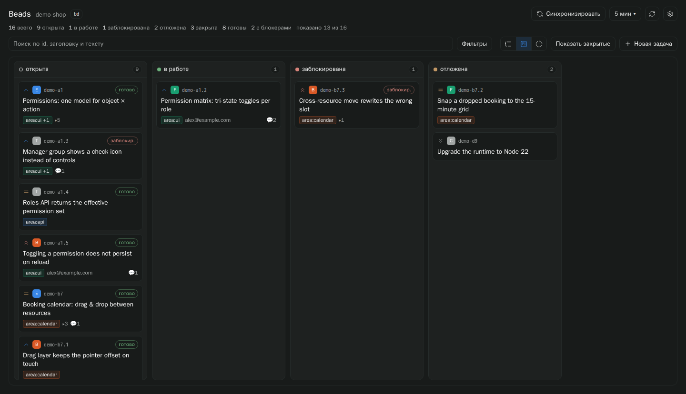

**Перемещение карточки меняет статус.** На web и в настольном приложении потяните
карточку в другую колонку — колонка под курсором подсветится, а отпускание запишет
новый статус. Это тот же однополевой запрос, каким пользуется меню статуса на
карточке, поэтому переход в `closed` по-прежнему идёт через `bd close`, и
`closed_at` остаётся честным. Отпускание в своей колонке или мимо доски не делает
ничего, а Esc во время перетаскивания отменяет его. Короткое нажатие без движения
по-прежнему открывает карточку. Пока идёт запись, карточка говорит об этом — и на
доске, и на открытой карточке задачи; если bd отказал, карточка остаётся на месте
и показывает причину. На телефоне или планшете перетаскивания нет: долгое нажатие
на карточку открывает меню «Перенести в» с остальными колонками. В режиме jsonl
писать некуда, поэтому карточки не перемещаются вовсе, и подсказка объясняет
почему.

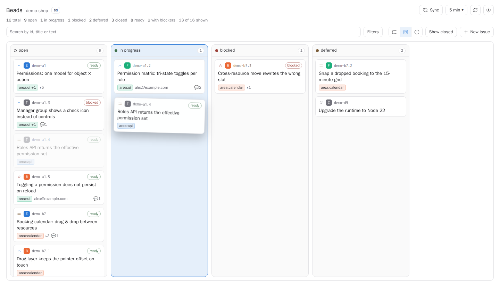

**Графики.** Третье положение переключателя превращает список в графики ровно тех
задач, что показали бы дерево и доска. Чтений четыре, они переключаются вверху
панели: как задачи распределены прямо сейчас («Срезы»), как работа двигалась за
период («Динамика»), кто её тянет («Исполнители») и кто её заводит («Авторы»).

Срезов шесть — по исполнителю, статусу, приоритету, готовности, типу и тегу. Они
читают тот же отбор, что и остальная панель (те же фильтры, тот же поиск, то же
«Показать закрытые»), поэтому полосы сдвигаются в тот же момент, что и фильтр, а
сумма на каждой полосе (кроме тегов) сходится с числом «показано» в шапке. Каждый
срез — карточка горизонтальных полос, по одной на значение, масштабированных от
собственной самой длинной полосы среза; значение никогда не пропадает из-за того,
что оно не заполнено: задачи без исполнителя попадают в свою полосу «не
назначено», без тегов — в «без тегов». Единственное исключение из правила суммы —
теги: задача с тремя тегами считается во всех трёх полосах, и карточка говорит об
этом подписью. Исполнители и теги ранжируются по количеству и режутся на восьми
именных полосах; остаток сворачивается в одну честную полосу «прочие». Цвета — те
же, что уже используют дерево и доска. Здесь ничего не пишется в задачу.

Полоса — ещё и вход внутрь. Нажатие сужает панель до этой корзины (нажали полосу
исполнителя — панель отфильтрована по нему), а все остальные срезы, счётчики в
шапке и список пересчитываются вместе с ней. Повторное нажатие на ту же полосу
снимает фильтр — как и чип, который она поднимает над списком. Полосы, за которыми
стоит группа значений, а не одно («прочие», «не назначено», «без тегов»,
незаданный приоритет), кнопками намеренно не сделаны, и подсказка говорит об этом.

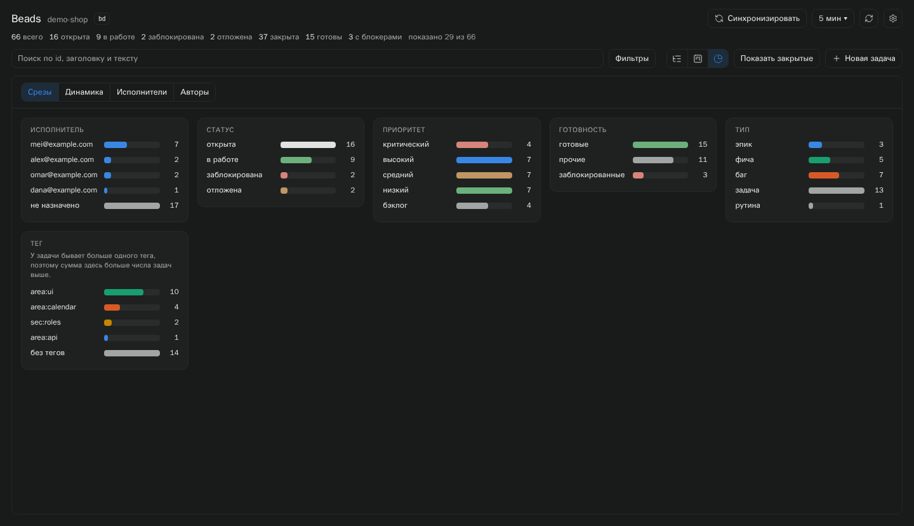

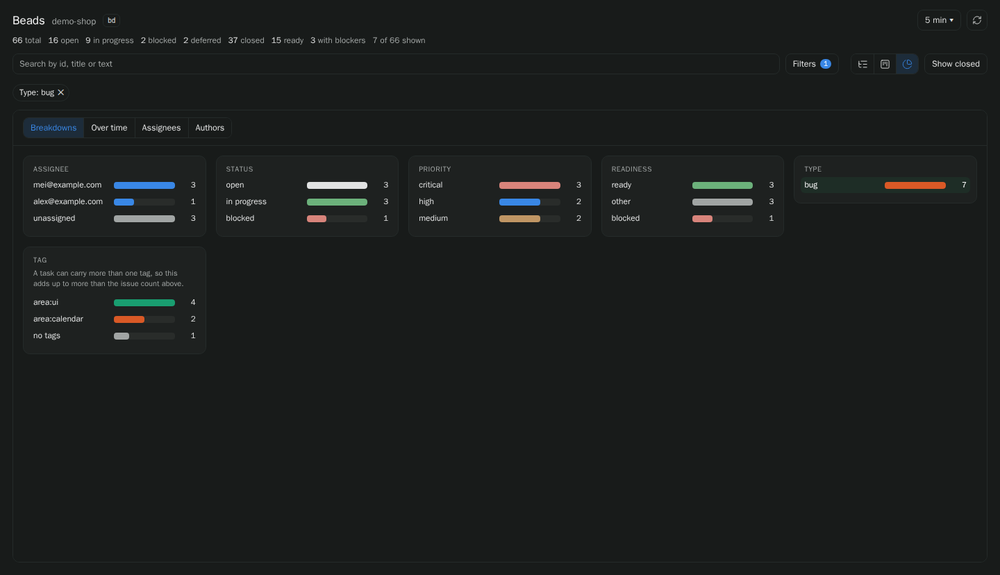

**Динамика.** Второе чтение отвечает на то, движется ли работа. Период (30, 90 или
180 дней либо вся история) задаёт, насколько далеко считать назад; шаг (авто,
день, неделя или месяц) задаёт ширину одного отрезка. На «авто» шаг следует
периоду; закрепить его нужно тогда, когда вопрос звучит как «сколько мы закрывали
каждую неделю» на промежутке, который период сам нарезал бы иначе. Шаг действует
сразу на все графики страницы, и у всех графиков одна общая ось времени, поэтому
дата стоит на всех них в одном и том же месте. Сверху шесть чисел: заведено,
закрыто, что стало с остатком за период, сколько открыто и сколько в работе прямо
сейчас, и медиана времени, которое уходило на закрытие задачи. Дальше:

- **Когда остаток разойдётся** — единственная величина про будущее, помеченная
  как оценка: открытое сейчас, делённое на то, насколько закрытие обгоняло
  заведение. Там, где остаток рос, называть нечего, и строка так и говорит.
- **Темп**: две линии — приходящая работа и доделываемая — скользящим средним по
  окну, выведенному из шага (неделя для дней, месяц для недель, квартал для
  месяцев); окно названо в подписи. Наведение на отрезок показывает его
  фактические числа; линия — это тренд.
- **Заведено и закрыто** по отрезкам — парными столбиками.
- **Работа во времени** — накопительный поток: каждая задача, существовавшая на
  этом шаге, в одном из трёх состояний (ожидает, в работе, сделано) стопкой от
  основания вверх. Стопка, растущая быстрее своего зелёного основания, — это
  остаток, убегающий от команды.
- **Ожидание и работа**: медиана времени в очереди против медианы времени, пока
  задачу делали.
- **Предсказуемость**: медиана времени до закрытия против её 85-го процентиля;
  узкая полоса между ними значит, что срок можно обещать.
- **Возраст открытого остатка**, **незавершёнка** и **баги: приход и уход** —
  доля багов в заведённом против их доли в закрытом.
- **Что стало с приходом каждого отрезка**: задачи, заведённые в одном отрезке,
  прослежены как когорта — закрытые за один отрезок, за два, за четыре и всего.

На web каждая отметка отзывается на курсор: при наведении она говорит, где стоит и
на сколько больше или меньше предыдущего отрезка, а остальное на этом графике
приглушается.

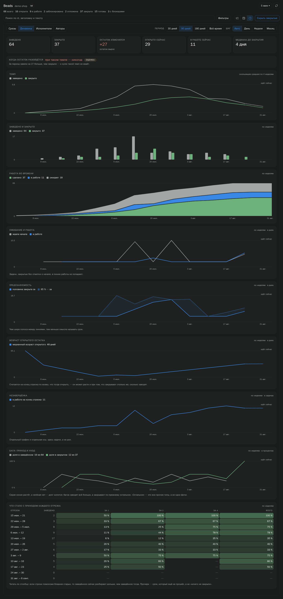

**Исполнители.** Строка на исполнителя, отранжированные по тому, сколько каждый
закрыл за период; число нарисовано ещё и полосой, а рядом спарклайн показывает,
ровно приходила эта работа или одним рывком. «В работе», «ожидает» и «всего» —
состояние прямо сейчас; «закрыл» — работа за период. Сортируется любая колонка.
Задачи, за которыми никого нет, получают свою строку, всегда последнюю. Нажатие на
имя открывает личную страницу: его числа, его ряд закрытий, его темп закрытий,
разрезы по статусу, приоритету и типу только по его задачам и то, что он держит, —
самое давнее сверху. Нажатие на такую задачу уводит в дерево и открывает её
карточку.

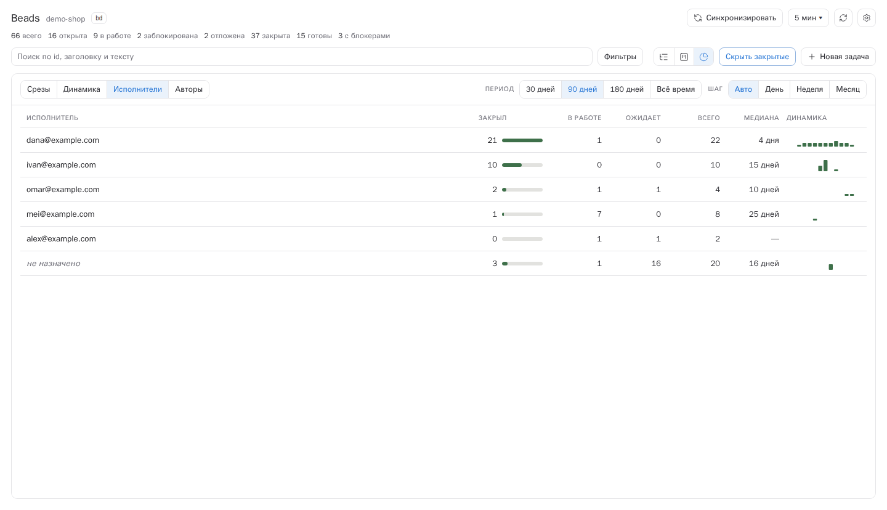

**Авторы.** Заводить работу и доделывать её — разные роли, и хранятся они в разных
полях, поэтому и чтения у них разные: строка на автора — сколько завёл за период,
сколько из этого уже закрыто и сколько ещё открыто, — и страница автора с теми же
числами, тем, что он заводил по отрезкам, сглаженным темпом заведения и тем, какого
рода работу он обычно заводит. Автора beads держит в отдельном поле, поэтому эти
имена не обязаны совпадать с именами исполнителей, и таблица говорит об этом под
собой.

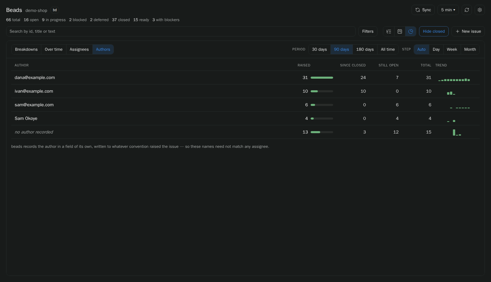

**Чего временные чтения не знают.** Beads хранит три момента на задачу (создана,
начата, закрыта) и никакой истории смены статусов, поэтому всё здесь восстановлено
из этих трёх. У переоткрытой задачи видно только последнее закрытие. Задача, чей
статус говорит, что она сдвинулась, но без метки времени, считается от момента
последнего изменения. Задача без даты создания в ряды не попадает, и график
говорит, сколько таких. **Исполнитель — текущий**: задача, закрытая полгода назад,
засчитывается тому, за кем она числится сегодня. И чтения подчиняются всем
фильтрам, включая «Показать закрытые»: когда закрытые скрыты (по умолчанию),
сделанным не считается ничего, и страница говорит об этом, тут же предлагая
переключатель.

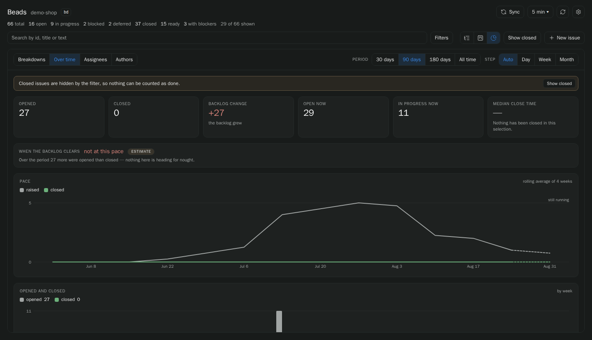

**Колонки и сортировка.** Кнопка «Столбцы» включает и выключает любую колонку
списка: приоритет, тип, идентификатор, теги, дети, готовность, статус, исполнитель,
даты создания и изменения, комментарии (последние четыре по умолчанию выключены).
Заголовок кликабелен: первый клик сортирует по возрастанию, второй по убыванию,
третий возвращает естественный порядок по идентификатору. **Сортировка
переставляет соседей, а не ломает иерархию** — ребёнок остаётся под своим
родителем при любой сортировке, а равенство разрешается по идентификатору, поэтому
порядок устойчив между обновлениями. Когда колонки не влезают, список
прокручивается вбок вместе со своим заголовком, а не ужимает заголовки задач в
многоточие.

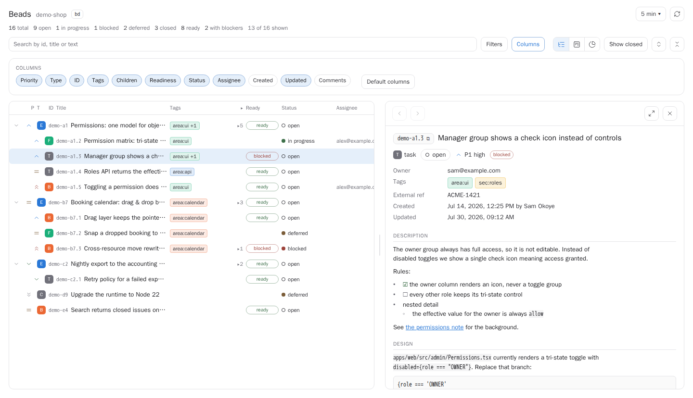

**На узкой вкладке** (собственная ширина вкладки меньше 900 px, например в сплите
рядом с другой, или всегда, когда Paseo сообщает о компактной раскладке, как в
окне размером с телефон) панель показывает один экран за раз: сначала список, по
выбору — карточка задачи на его месте во всю вкладку, с кнопкой назад к дереву или
доске. Пока открыта карточка, панель инструментов (поиск, фильтры, переключатель
вида) убрана; заголовок и счётчики остаются. Если из этой карточки переходили по
ссылкам, первая кнопка вместо этого — **Назад** по ним, а крестик сразу
возвращает к списку. При возврате задача остаётся выбранной, а список прокручен
туда же, где был, на доске — и вбок тоже. Доска сужает свои колонки так, чтобы на
экран вставали одна и краешек следующей, и листается свайпом вбок. Разделитель
здесь спрятан.

**Ширина карточки.** На web и в настольном приложении между списком и карточкой
есть разделитель: потяните его, чтобы дать карточке больше места; двойной клик
возвращает пропорции по умолчанию. Списку всегда остаётся не меньше 340 px.

**Закрытые задачи по умолчанию скрыты.** Кнопка на панели инструментов называет
действие, а не состояние: «Показать закрытые» или «Скрыть закрытые». Если родитель
видимой задачи скрыт фильтром, задача не исчезает: она поднимается под ближайшего
видимого предка (или на верхний уровень) и помечается стрелкой `↳`.

**Поиск и фильтры.** Поиск живой. По идентификаторам, заголовкам и тегам он идёт в
самой панели прямо по мере набора; описания, дизайн, критерии и заметки ищет демон
(`beads.search`), поэтому тяжёлые тексты никогда не едут к клиенту. Ветки, ведущие
к найденному, раскрываются сами. Запрос, целиком совпадающий с ключом задачи,
находит ровно эту задачу: ключи вложены друг в друга (`demo-a1` — начало
`demo-a1.2`) и цитируются в других задачах, поэтому простой поиск по подстроке
хоронит ту единственную задачу, которую спросили.

Фильтры живут в панели со счётчиками: статус, тип, приоритет и готовность
(ready / blocked), все с множественным выбором. «Создано» — временное окно
(последний день, 7, 30 или 90 дней). Теги — множественный выбор с поиском и
счётчиками, несколько тегов работают как ИЛИ. Исполнитель — список, собранный из
реально встречающихся исполнителей; он совпадает именно с этим полем, а не с
владельцем. Активные фильтры висят чипами под панелью инструментов и снимаются по
одному или все разом; нажатие на тег в карточке добавляет его в тот же фильтр.

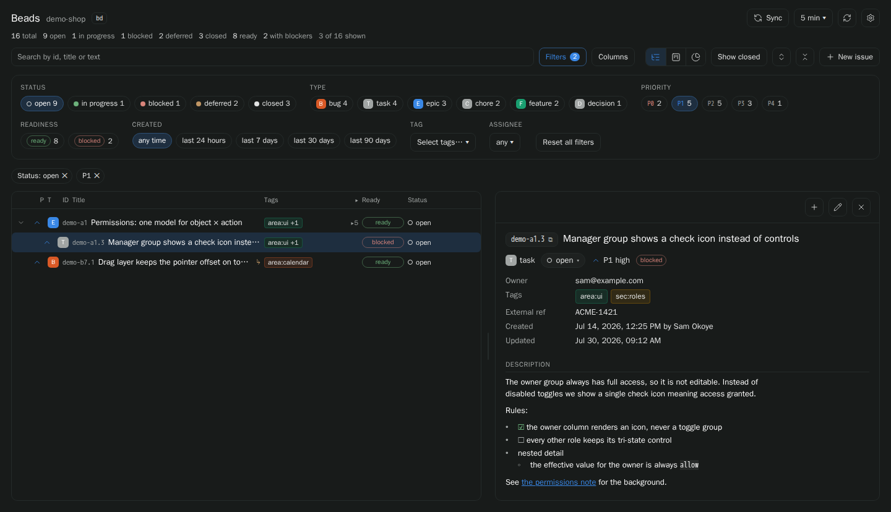

**Карточка.** Ключ стоит слева от заголовка (и копируется по нажатию), дальше тип,
статус, приоритет (иконка плюс уровень P и его название, например «P1 высокий»),
владелец и исполнитель, теги цветными чипами, `external_ref`, все даты и причина
закрытия. Текстовые блоки `description` / `design` / `acceptance_criteria` /
`notes` отрисовываются как Markdown — собственным рендерером плагина, который
строит компоненты, а не разметку.

**Ключ задачи, написанный в тексте, — ссылка.** Ключ, упомянутый в прозе внутри
любого из текстовых блоков или комментария, становится нажимаемым, но только если
такая задача в проекте действительно есть, и никогда — внутри `code`, блока кода
или уже существующей ссылки. Нажатие открывает эту задачу: раскрывает ветку в
дереве, прокручивает к строке и, если задача закрыта, а закрытые скрыты, включает
«Показать закрытые».

**Статус — это управление, а не подпись.** Нажатие на него открывает список
статусов, и выбранный записывается сразу же — тем же путём `bd close` /
`bd reopen`, каким идёт форма редактирования. В режиме jsonl он остаётся подписью.

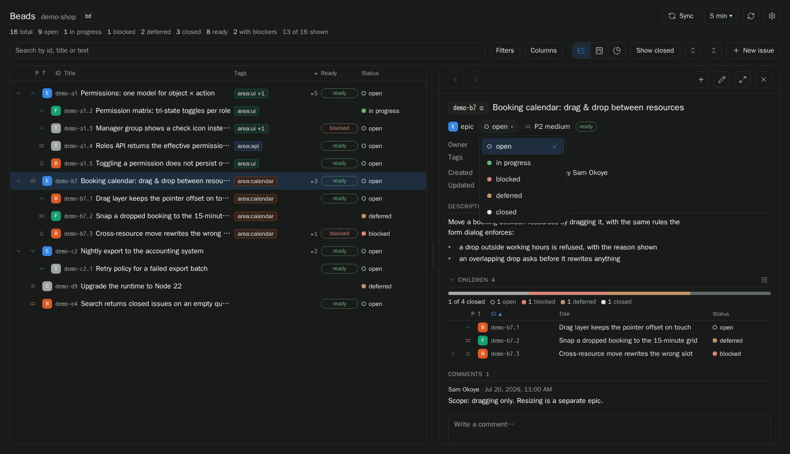

**Связанные задачи — маленькие таблицы.** Каждый тип связи (родитель, дети,
блокеры, что блокирует сама задача, `discovered-from` и всё, что ещё добавит beads)
получает заголовок с сортировкой, переключатель колонок, а для детей — полосу
прогресса по их статусам с легендой в цветах самой полосы. Блок детей — дерево: у
ребёнка, у которого есть свои дети, появляется треугольник, и они свёрнуты, пока
не попросят. Каждый блок сворачивается по клику на заголовок и оставляет счётчик.
Переход по связи раскрывает ветку в дереве, прокручивает к задаче и подсвечивает
её; кнопка **Назад** в шапке карточки возвращает к карточке, из которой
перешли. Она видна, только когда есть куда вернуться, а выбор задачи в дереве или
на доске начинает путь заново. Чтобы читать две карточки рядом, откройте вторую
вкладку Beads через «+» и поставьте её в сплит рядом с первой: вкладками и
сплитами управляет Paseo, а не панель.

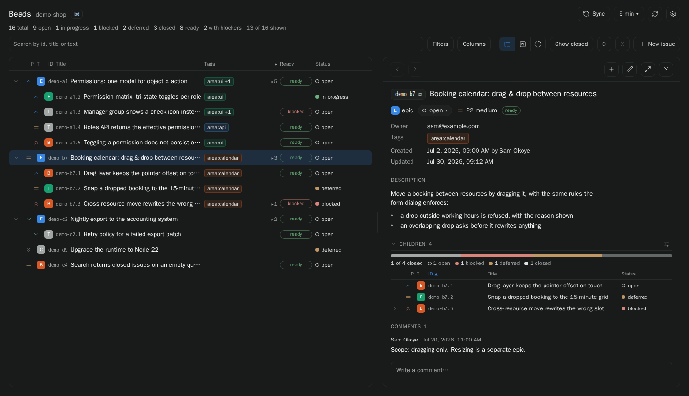

**Комментарии** дописываются, но не правятся, потому что так устроен beads: `bd`
предлагает `bd comment` (добавить) и `bd comments` (показать) и ничего, чтобы
отредактировать или удалить комментарий. Поэтому панель их читает и пишет, но не
притворяется, что умеет править. Отрисовываются они как Markdown и сортируются по
дате в обе стороны. Под веткой есть поле для нового: Ctrl+Enter (Cmd+Enter на Mac)
или кнопка отправляет его, и ветка растёт без обновления. Черновик остаётся в поле,
пока вы смотрите другие задачи, — всё время, пока панель открыта. Подсказка под
полем говорит, чьё имя получит комментарий.

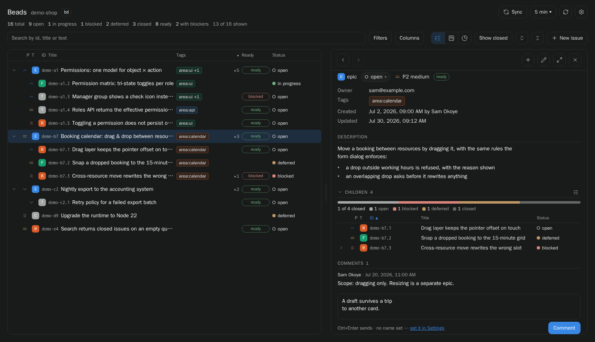

**Страница настроек.** Шестерёнка в шапке панели открывает страницу плагина в
«Настройках» Paseo. Настроек на ней две, они хранятся на хосте демона и общие для
всех его клиентов (в проект никогда не пишутся):

- **Ваше имя.** Пользуются им двое. Кнопка **Назначить меня** рядом с исполнителем
  в карточке записывает поле сразу; она появляется, только если имя задано и
  задача ещё не ваша. И авторство комментариев: с заданным именем комментарий
  сохраняется от него, без имени bd записывает собственную подпись плагина, а
  подсказка под полем комментария говорит, что из двух сейчас произойдёт, — со
  ссылкой на страницу настроек, если имени ещё нет.
- **Частота обновления**: 10, 30 или 60 секунд, 5 или 15 минут (по умолчанию
  5 минут). Тот же выбор есть в шапке панели.

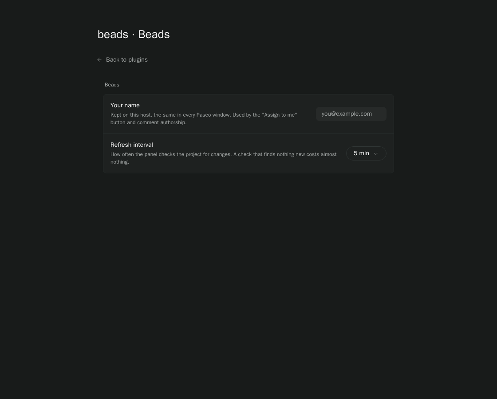

**Редактирование.** Кнопка-карандаш в шапке карточки открывает форму: заголовок,
тип, статус, приоритет, исполнитель, теги, родитель, `external_ref` и четыре
текстовых блока. Отправляются только реально изменённые поля: `bd update --notes`
перезаписывает заметки целиком, поэтому нетронутые поля передавать нельзя. Кнопка
сохранения остаётся неактивной, пока ничего не изменилось; закрытие формы с
набранным текстом сначала переспрашивает. Ошибка записи остаётся в форме текстом,
и ничего набранного не теряется. Тип, статус и приоритет — пикеры с теми же
иконками, что и в списке; исполнитель, теги и родитель подсказывают то, что в
проекте уже есть, и принимают свободный текст.

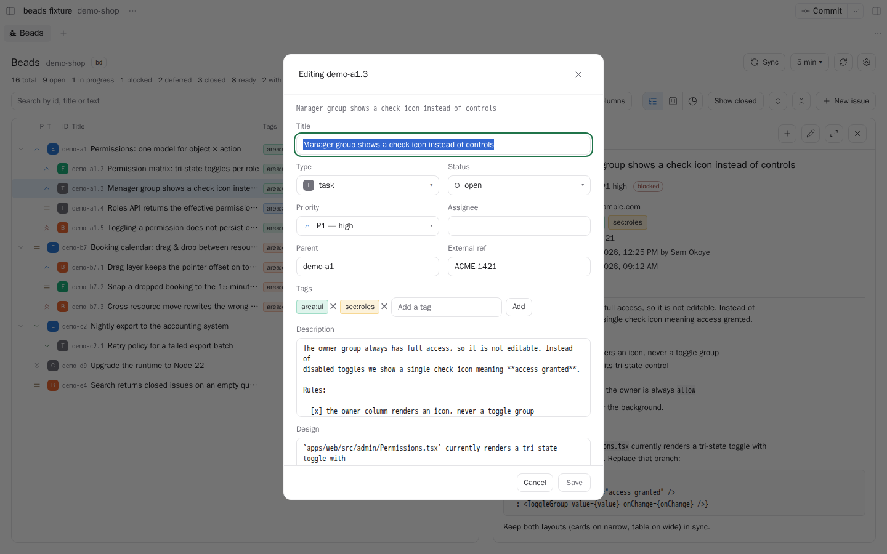

**Создание.** Кнопка **Новая задача** на панели инструментов открывает ту же форму
пустой; **+** в шапке карточки открывает её с этой задачей, уже подставленной как
родитель, — так и делается подзадача. Как только bd ответит, панель выбирает
созданную задачу и показывает её в дереве. Что можно менять и как устроен путь
записи — в [Как устроена запись](writing.md).

**Синхронизация.** Кнопка **Синхронизировать** в шапке возвращает `issues.jsonl` и
базу в согласие, в обе стороны, никогда не давая старым данным затереть более
свежие; значок рядом говорит, что сейчас идёт, а по завершении — что пришло из
файла. Подробности — в
[Как устроена запись](writing.md#sync-как-снова-согласовать-файл-и-базу).

`ready` означает ровно то же, что `bd ready`: задача открыта и все её блокеры
закрыты. Считается по снимку, без отдельного вызова, и тесты сверяют результат с
настоящим `bd ready`.

**Автообновление.** С выбранной частотой панель спрашивает у демона дешёвый маркер
изменений и перезапрашивает дерево, только если он сдвинулся, да и тогда — лишь
изменившиеся задачи; пока приложение в фоне, опрос останавливается. Сколько бы
вкладок Beads ни показывали рабочее пространство, вместе с панелью Beads в боковой
панели, проверка для него идёт одна. Изменившиеся задачи ненадолго подсвечиваются — видно,
как работают агенты. Обновление не сбивает ни выделение, ни раскрытые ветки, ни
позицию прокрутки, ни место в карточке.

**Когда обновление не удалось.** Неудачное обновление никогда не стирает список на
экране. Строки остаются, а под счётчиками появляется спокойная полоса «Данные могут
быть устаревшими» с причиной, сказанной словами («В проекте не инициализирован
beads», «bd не ответил вовремя»), с сырым кодом в подсказке и кнопкой
**Повторить**. После следующего удачного ответа она исчезает сама. Пока обновления
продолжают падать, опрос замедляется, удваивая паузу вплоть до 5 минут. Карточка,
которую не удалось перезагрузить, остаётся открытой с пометкой «Может быть
устаревшей». Рабочее пространство, которое ещё ни разу не загрузилось, показывает проблему
пустым состоянием с подсказкой и кнопкой **Повторить**.

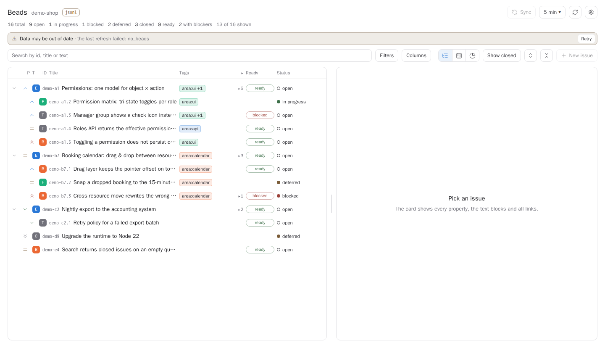

**Возвращение мгновенное.** Пока приложение открыто, оно держит в памяти последний
удачный список для восьми рабочих пространств и открытые в них карточки — одну
копию на все вкладки Beads и панель Beads в боковой панели этого хоста, поэтому повторное
открытие вкладки, вторая вкладка или возврат к рабочему пространству рисуют список
сразу и проверяют изменения в фоне. Хост демона к тому же хранит последний список
каждого проекта на диске, поэтому после перезагрузки плагина или рестарта демона
вкладка сразу рисует задачи из этой копии, пока за ней опрашивается `bd`. Пока
свежие строки в пути, рядом с заголовком видна ненавязчивая метка **Обновляется…**
(только если обновление затянулось дольше мгновения); когда они приходят, они
встают на место старых, а выбор, раскрытые ветки, прокрутка и открытая карточка
остаются где были. На устройстве из задач не хранится ничего, потому что в тексте
задач бывают секреты; что хранит хост, где и как это удалить — в
[Приватности и тексте задач](privacy.md), как копии поддерживаются свежими — в
[Как устроено чтение](reading.md).

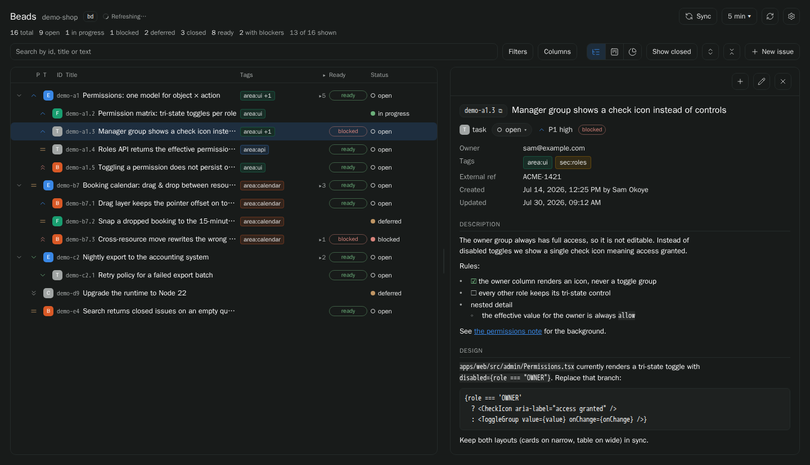

## Платформы

Панель написана один раз для всех клиентов Paseo, а клиенты различаются тем, что
умеют:

- **Web и настольное приложение (Electron)**: всё описанное выше. Графики
  интерактивны (подсказки при наведении, приглушение), подсказки показываются при
  наведении, доска и разделитель перетаскиваются, меню слушаются клавиатуры
  (стрелки, Enter, Esc).
- **iOS и Android**: та же панель; на телефоне это узкая вкладка, один экран за
  раз, и боковой панели там нет (быстрый путь — лист кнопки в шапке). Графики рисуются статичными
  картинками (без подсказки при наведении), всплывающих подсказок нет, на доске нет
  перетаскивания — статус меняется через меню «Перенести в» по долгому нажатию, а
  ширина карточки фиксирована. **На устройстве эти сборки ещё не пробовали**:
  нативные пути проверены типами, но не руками, поэтому ждите шероховатостей и,
  пожалуйста, сообщайте о них.

## Язык

Интерфейс русский и английский. Язык следует собственной настройке приложения
Paseo и переключается вместе с ней, без перезагрузки; любой другой язык приложения
отрисовывается по-английски.

---

[← Оглавление документации](README.md) · [README проекта](../../README.ru.md)
