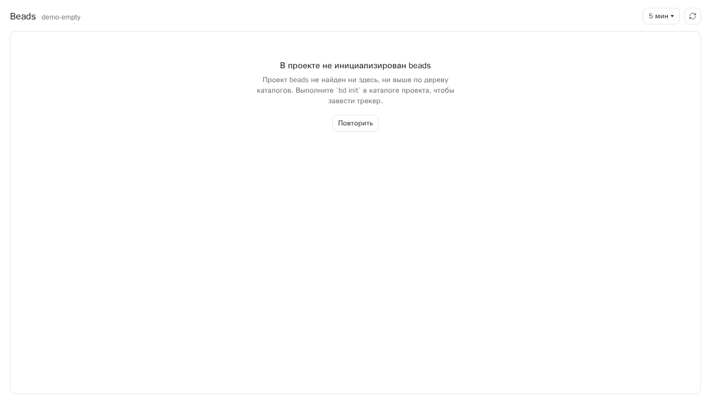
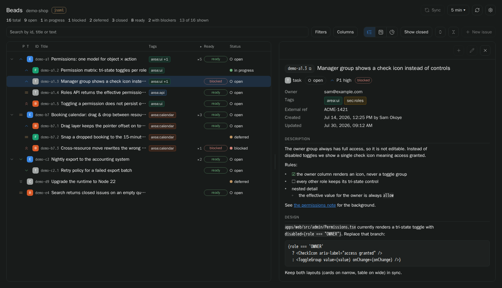

# Два режима: `bd` и `jsonl`

[English](../modes.md) · **Русский**

Как плагин решает, откуда читать проект, и что он может и чего не может в каждом режиме.

Beads держит данные в `<проект>/.beads/`. Проекты бывают в двух состояниях, и
плагин поддерживает оба. Режим показан значком рядом с именем проекта в шапке
панели.

| Значок | Когда | Откуда берутся данные |
|---|---|---|
| `bd` | база развёрнута | `bd --readonly --json list --all -n 0` |
| `jsonl` | базы нет, есть только экспорт | `.beads/issues.jsonl`, разбирается построчно |

Режим определяется не наличием каталога, а фактом: сначала пробуется CLI, и если
`bd` отвечает «no beads database found», плагин откатывается к jsonl. Так он не
зависит от внутреннего устройства beads.

Откат нужен проектам без базы, а не базе, которая один раз дала сбой. Проект,
который уже отвечал из `bd` и затем получил ненулевой код выхода (например, база
заблокирована), остаётся в режиме `bd`: панель продолжает показывать последнюю
удачную копию с полосой «Данные могут быть устаревшими», а ошибка приходит как
`bd_failed` — см. [Как устроено чтение](reading.md).

**Чего не хватает режиму jsonl.** Экспорт беднее, чем ответ CLI, и интерфейс тихо
деградирует: теги, `design`, `acceptance_criteria`, тела комментариев (остаётся
только их количество) и `external_ref` остаются пустыми. Запись (правки, новые
задачи, комментарии, смена статуса, перенос карточек на доске) требует базы,
поэтому здесь эти элементы управления выключены, а причина написана в подсказке, и
демон отказывает в них с `read_only_mode`, даже если попросить напрямую. Родитель в
этом режиме не приходит отдельным полем — он выводится из связи `parent-child`, так
что дерево всё равно собирается целиком.

Даты и исполнитель экспорт переживают (`created_at`, `started_at`, `closed_at` и
`assignee`), так что чтения графиков по времени и по людям работают здесь так же,
как в режиме `bd`.

**`bd` должен быть на хосте демона.** Плагин работает внутри демона Paseo, поэтому
`bd` ищется в `PATH` процесса демона (а если там нет — в `/usr/local/bin` и
`/usr/bin`). Без него проект с базой прочитать нельзя, и панель пишет «bd не найден»
с подсказкой.

Если ни в каталоге рабочего пространства, ни где-либо выше `.beads` не нашлось,
панель показывает пустое состояние с подсказкой (`bd init`), а не ошибку.

---

[← Оглавление документации](README.md) · [README проекта](../../README.ru.md)
