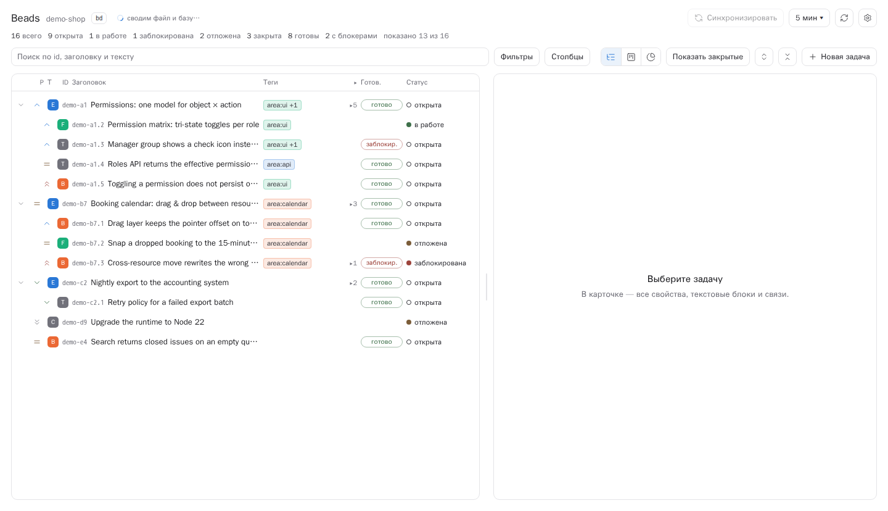
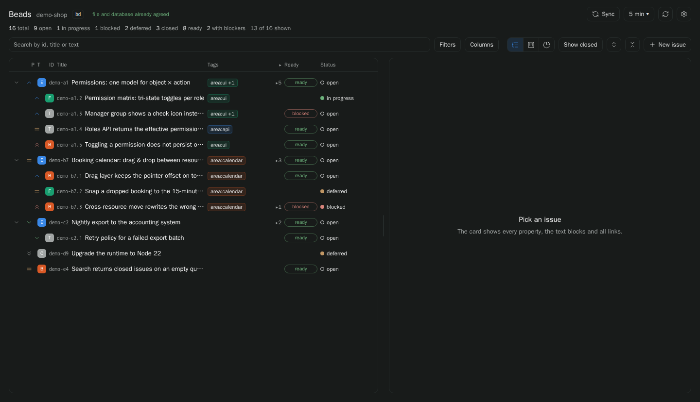
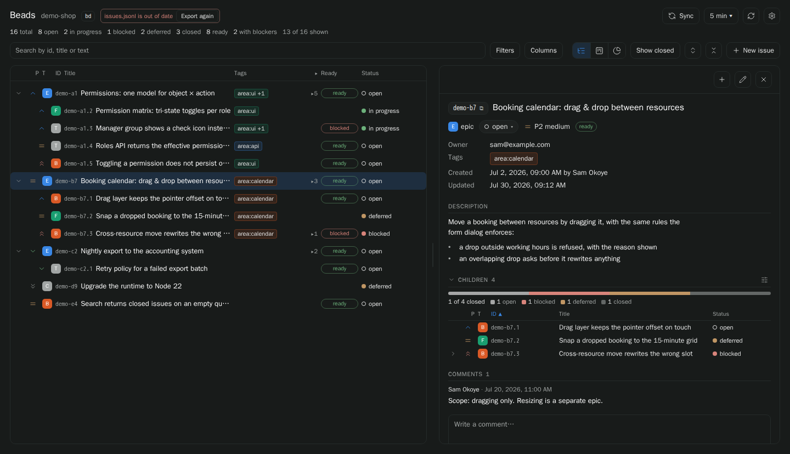

# Как устроена запись

[English](../writing.md) · **Русский**

Что можно изменить, а что нельзя, как синхронизация сводит две половины beads-проекта и почему экспорт идёт в фоне.

**Запись — это отдельные RPC.** Пишут пять RPC, и больше ничто:
`beads.edit`, `beads.create`, `beads.comment`, `beads.export` и `beads.sync`.
Каждый принимает id воркспейса, а не путь, и демон находит проект так же, как при
чтении. Запускать они могут только закрытый набор подкоманд `bd`: `create`,
`update`, `close`, `reopen`, `comment`, `export` и `import`. `delete` в набор не
входит, а сам набор проверяется до запуска `bd`, так что уничтожить задачу в
плагине нечем. Любой ввод проверяется ещё до обращения к `bd` (известные статус и
тип, приоритет от 0 до 4, размеры в пределах лимитов), а неверное поле возвращается
точным кодом вроде `bad_priority`, а не общей ошибкой.

**Создание задач.** Кнопка **Новая задача** открывает форму пустой; **+** в шапке
карточки открывает её с этой задачей, подставленной как родитель, — так и делается
подзадача. Статуса в форме здесь нет (у `bd create` нет `--status`, и новая задача
открыта по определению), а приоритет стартует с P2, собственного значения bd по
умолчанию. Идентификатор принадлежит bd: ответ приносит тот, который тот выдал, и
панель выбирает и показывает эту задачу в дереве. Тег с запятой внутри
отклоняется, потому что `bd create -l` разделяет теги запятыми и тихо разрезал бы
его надвое.

**Что можно изменить.** Заголовок, тип, статус, приоритет, исполнителя, теги
(добавить и убрать), родителя, `external_ref` и четыре текстовых блока.
Отправляются только поля, которые действительно изменились, потому что
`bd update --notes` и его собратья перезаписывают поле целиком. Смена статуса идёт
правильными командами: переход в `closed` — через `bd close` (который проставляет
`closed_at` и причину закрытия), выход из `closed` — через `bd reopen` (который их
очищает); всё остальное — обычный `bd update -s`. Управление статусом в самой
карточке, **Назначить меня** и карточка, перетащенная по доске, отправляют одно и
то же однополевое изменение, поэтому идут тем же путём и подчиняются тому же
правилу «одна запись за раз»; отказ оставляет карточку там, где она была, с
причиной на ней.

**Комментарии** — отдельная маленькая запись: `beads.comment` запускает
`bd comment <id> <текст>`, передавая тело одним элементом argv, поэтому
многострочный комментарий остаётся одним комментарием. Пустой отклоняется ещё до
обращения к bd, а ответ приносит пересобранную карточку вместе с веткой.
Комментарий — единственная запись, которая несёт с собой имя: заданное на странице
настроек плагина уходит вместе с ним как `bd --actor`, и именно его beads сохраняет
автором комментария. Проверяется оно, как любой другой ввод (строка не длиннее
200 байт); если имя не задано, комментарий уходит под запасным именем, описанным
ниже.

**Чего нельзя.** `owner` не редактируется: у `bd update` нет `--owner`, и поля нет
в форме. Задачи нельзя удалить. В **режиме jsonl** писать некуда (`bd` там умирает
с «no beads database found»), поэтому элементы записи выключены с объяснением в
подсказке, а демон отклоняет запись с `read_only_mode`, даже если попросить его
напрямую.

**Плагин не создаёт git-коммитов.** Ни одного, никогда: индексировать и коммитить
решает владелец. Плагин никогда не запускает `git add`, `git commit` или
`bd dolt commit`. Запись уходит как
`bd --json --actor <кто> --dolt-auto-commit off create|update|close|reopen …` в
каталоге проекта, и `--dolt-auto-commit off` передаётся явно при каждой записи: на
некоторых версиях `bd` без явного флага dolt-коммит всё равно создаётся, хотя
справка заявляет `off` как значение по умолчанию. Актор — это имя, которое
комментарий принёс со страницы настроек; для всякой другой записи, а также для
комментария, отправленного без заданного имени, это `$BEADS_ACTOR` из окружения
демона, а если и его нет — `paseo-beads`, так что действие никогда не попадает в
журнал событий beads с пустым именем. Историю Dolt плагин тоже не трогает, с одним
выверенным исключением: см. [Sync](#sync-как-снова-согласовать-файл-и-базу) ниже.

**О записи сообщает сам `bd`.** Как только `bd` принял запись, ответ — `ok: true`,
даже если перечитывание после неё не укладывается в бюджет RPC: тогда карточка
возвращается как `null` с `reloading: true`, и панель забирает её, когда загрузка
завершится.

## Sync: как снова согласовать файл и базу

Две половины beads-проекта расходятся сами собой: агент, работающий через `bd`,
двигает базу и оставляет `issues.jsonl` позади, а `git pull` или правка руками
двигает файл и оставляет позади базу. Кнопка **Синхронизировать** в шапке панели
чинит оба случая:

1. `bd import` втягивает файл в базу. Он запускается **без** `--allow-stale`,
   поэтому любая строка старше того, что база уже содержит, пропускается: устаревший
   файл не может затереть более свежую работу. Тесты записи проигрывают ровно этот
   случай против настоящего `bd`.
2. `bd export` выписывает базу обратно, и файл становится её точным дампом.

Сначала импорт, потом экспорт: обратный порядок опубликовал бы базу поверх файла
раньше, чем прочитал бы, что файлу было сказать. Если импорт провалился, экспорт
**не** запускается. То, что сдвинулись обе стороны, — не беда, пока они сдвинулись
по разным задачам; когда по одной и той же, побеждает более свежая отметка времени.

Синхронизацию запускает RPC, а дальше она идёт в фоне, потому что может длиться
дольше, чем позволено RPC; панель следит за ней через `beads.job-status` и
`beads.revision`. Индикатор рядом со значком режима говорит, какая половина сейчас
работает, а по завершении — что пришло из файла («подтянуто из файла: новых 2»)
или что делать было нечего.

Две вещи, которые стоит знать. Задача, удалённая из базы, но оставшаяся в файле,
**вернётся**: у «привести обе стороны к согласию» нет способа отличить удаление от
строки, которой база никогда не видела. И `bd import` пишет **dolt**-коммит всякий
раз, когда действительно что-то меняет: флага, чтобы это подавить, у него нет, а
`--dolt-auto-commit off` этот случай не покрывает. Такая история остаётся внутри
`.beads`; git по-прежнему не тронут.

## Экспорт в `issues.jsonl` идёт в фоне

После каждой правки, создания или комментария запись в базу отвечает сразу, а
`bd export -o .beads/issues.jsonl` запускается в фоне (у RPC нет «после ответа»,
поэтому он запрашивается прямо перед ним). Между сохранением и обновлением файла
на диске на большом проекте есть окно в одну-две секунды. Индикатор в шапке
показывает это честно:

- пока экспорт идёт — спокойное «обновляем issues.jsonl…»;
- когда он удался — гаснущее подтверждение;
- если экспорт провалился или демон остановился на середине — заметное, но не
  блокирующее «issues.jsonl устарел» с кнопкой **Экспортировать ещё раз** и текстом
  ошибки в подсказке. Данные в базе при этом не теряются: файл просто остаётся
  таким, каким был, до следующего сохранения или повтора. Файл пишет только
  `bd export`; плагин никогда не трогает его напрямую.

Несколько правок подряд не вызывают по экспорту каждая: пока один экспорт идёт,
дальнейшие правки лишь помечают «нужен ещё один», так что три быстрых сохранения
стоят не больше двух экспортов. Дерево перечитывается сразу после записи, ещё до
того как экспорт стартовал.

**Экспорт ничего не выбрасывает.** По умолчанию `bd export` исключает воспоминания
и инфраструктурные записи (агенты, роли, сообщения). Перед каждым экспортом плагин
смотрит, записи каких типов уже есть в текущем `issues.jsonl`, и если там есть
воспоминания или инфраструктурные записи, экспорт просят их сохранить
(`--include-memories` / `--include-infra`).

**Первый экспорт может дать большой diff.** Если `issues.jsonl` проекта отстал от
базы (правки шли через `bd` напрямую, без экспорта), первое сохранение через плагин
подтягивает файл до текущего состояния базы — возможно, с десятками изменённых
строк и другим порядком. Последующие diff'ы — по строке на изменённую задачу.
Прежде чем коммитить такой diff, посмотрите на него.

**Альтернатива, которую плагин не трогает.** У beads есть встроенный автоэкспорт
(`bd config`: `export.auto` и соседние, по умолчанию выключен). Он ловит и правки,
сделанные вне этой панели. Плагин не включает и не меняет эту настройку в чужом
проекте; включить её — решение владельца.

---

[← Оглавление документации](README.md) · [README проекта](../../README.ru.md)
