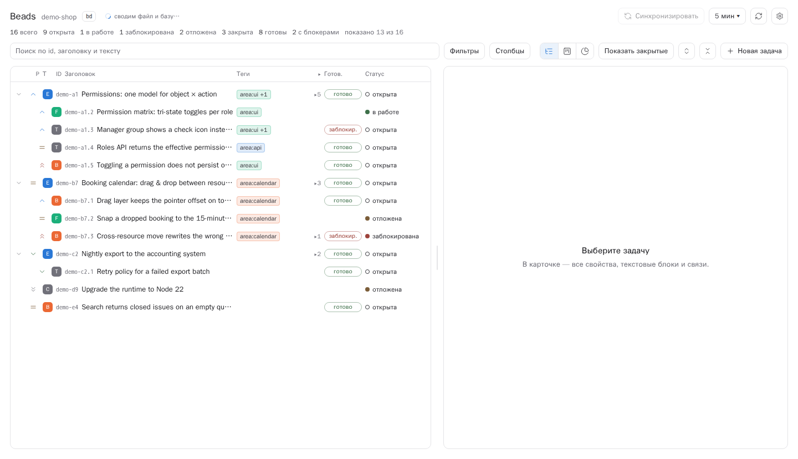
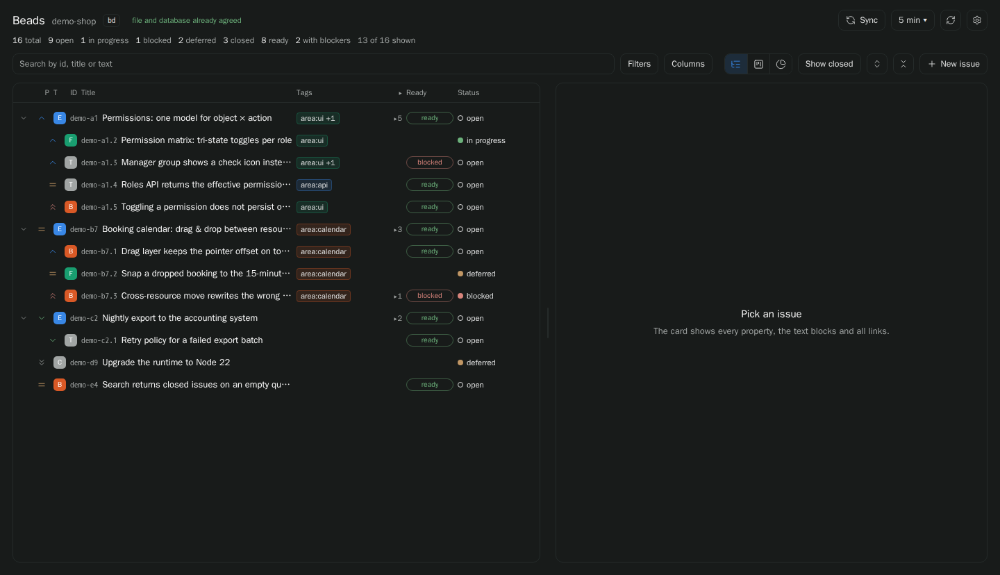
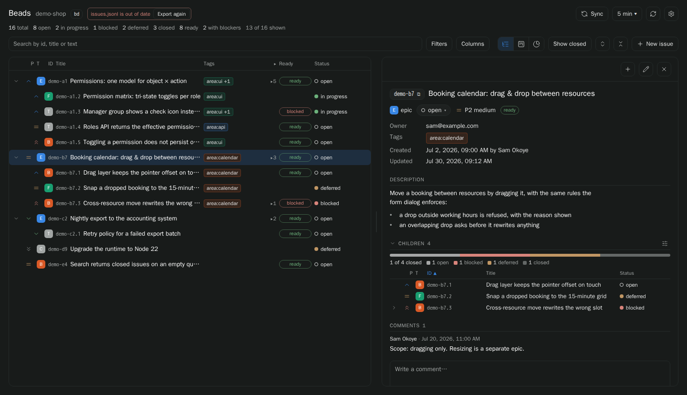

# How writing works

**English** · [Русский](ru/writing.md)

What can be changed and what cannot, how Sync reconciles the two halves of a beads project, and why the export runs in the background.

**Writes are their own RPCs.** Five RPCs write and nothing else does:
`beads.edit`, `beads.create`, `beads.comment`, `beads.export` and `beads.sync`.
Each takes the workspace id, never a path, and the daemon resolves the project the
same way it does for reads. They may run only a closed set of `bd` subcommands:
`create`, `update`, `close`, `reopen`, `comment`, `export` and `import`. `delete`
is not in the set, and the set is checked before `bd` is started, so nothing in
the plugin can destroy an issue. Every input is validated before `bd` is asked (a
known status and type, a priority from 0 to 4, sizes within limits), and a bad
field comes back as a precise code such as `bad_priority`, not a generic error.

**Creating issues.** The **New issue** button opens the form empty; the **+** in a
card header opens it with that issue prefilled as the parent, which is how a
subtask gets made. Status is absent from the form here (`bd create` has no
`--status` and a new issue is open by definition), and the priority starts at P2,
bd's own default. The id belongs to bd: the reply carries whatever it minted, and
the panel selects and reveals that issue in the tree. A tag containing a comma is
refused, because `bd create -l` is comma-separated and would quietly split it in
two.

**What can be changed.** Title, type, status, priority, assignee, tags (added and
removed), parent, `external_ref` and the four text blocks. Only the fields that
actually changed are sent, because `bd update --notes` and its siblings overwrite
a field wholesale. Status changes go through the proper commands: a move into
`closed` uses `bd close` (which sets `closed_at` and the close reason), leaving
`closed` uses `bd reopen` (which clears them); everything else is a plain
`bd update -s`. The card's own status control, **Assign to me** and a card moved
across the board all send the same one-field edit, so they take the same path and
the same one-write-at-a-time rule; a refusal leaves the card where it was with the
reason on it.

**Comments** are their own small write: `beads.comment` runs `bd comment <id>
<text>` with the body as a single argv element, so a multi-line comment stays one
comment. An empty one is refused before bd is asked, and the reply carries the
rebuilt card, thread included. A comment is the one write that carries a name: the
one set on the plugin's settings page travels with it as `bd --actor`, which is
what beads stores as the comment's author. It is checked like any other input (a
string of at most 200 bytes); with no name set the comment goes out under the
fallback identity below.

**What cannot be changed.** `owner` is not editable: `bd update` has no `--owner`,
and the field is not in the form. Issues cannot be deleted. In **jsonl mode**
there is nowhere to write (`bd` dies there with "no beads database found"), so the
write controls are disabled with an explanation in the tooltip, and the daemon
refuses a write with `read_only_mode` even if asked directly.

**The plugin creates no git commits.** Not one, ever: staging and committing are
the owner's decision. The plugin never runs `git add`, `git commit` or
`bd dolt commit`. A write goes out as
`bd --json --actor <who> --dolt-auto-commit off create|update|close|reopen …` in
the project's directory, and `--dolt-auto-commit off` is passed explicitly on every
write: on some `bd` versions a Dolt commit is still created without the explicit
flag, despite the help claiming `off` as the default. The actor is the name a
comment brought from the settings page; for every other write, and for a comment
posted with no name set, it is `$BEADS_ACTOR` of the daemon's environment, and
failing that `paseo-beads`, so the action never lands in beads' event log with an
empty name. Dolt history is left alone too, with one measured exception: see
[Sync](#sync-putting-the-file-and-the-database-back-in-step) below.

**A write is reported by `bd` itself.** Once `bd` has accepted a write, the reply is
`ok: true` even if the reload after it does not fit in the RPC's budget: the card
then comes back as `null` with `reloading: true`, and the panel fetches it when the
load is done.

## Sync: putting the file and the database back in step

The two halves of a beads project drift apart on their own: an agent working
through `bd` moves the database and leaves `issues.jsonl` behind, while a `git
pull` or a hand edit moves the file and leaves the database behind. The **Sync**
button in the panel header fixes both cases:

1. `bd import` pulls the file into the database. It runs **without**
   `--allow-stale`, so any row older than what the database already holds is
   skipped: a stale file cannot overwrite newer work. The write tests drive
   exactly this case against a real `bd`.
2. `bd export` writes the database back out, so the file becomes a faithful dump
   of it.

Import first, export second: the other order would publish the database over the
file before reading what the file had to say. If the import fails, the export is
**not** run. Both sides moving at once is fine as long as they moved on different
issues; when they moved on the same one, the newer timestamp wins.

Sync is started by the RPC and runs on in the background, because it can take
longer than an RPC may; the panel follows it through `beads.job-status` and
`beads.revision`. The badge next to the mode says which half is running and, when
it is done, what came in from the file ("pulled in from the file: 2 new") or that
there was nothing to do.

Two things worth knowing. An issue that was deleted from the database but is
still in the file comes **back**: "make both sides agree" cannot tell a deletion
from a row the database never saw. And `bd import` writes a **Dolt** commit
whenever it actually changes something: it has no flag to suppress that, and
`--dolt-auto-commit off` does not cover it. That history stays inside `.beads`;
git is still untouched.

## The export to `issues.jsonl` runs in the background

After every edit, create or comment the database write answers at once, and
`bd export -o .beads/issues.jsonl` is started in the background (an RPC has no
"after the reply", so it is requested just before it). Between the save and the
file being updated on disk there is a window of a second or two on a large
project. The badge in the header shows this honestly:

- while the export runs, a calm "updating issues.jsonl…";
- when it succeeds, a fading confirmation;
- if the export failed, or the daemon stopped mid-way, a noticeable but
  non-blocking "issues.jsonl is out of date" with an **Export again** button and
  the error in its tooltip. Nothing in the database is lost meanwhile: the file
  simply stays as it was until the next save or a retry. The file is only ever
  written by `bd export`; the plugin never touches it directly.

Several edits in a row do not each start an export: while one runs, further edits
only mark "one more needed", so three quick saves cost no more than two exports.
The tree reloads right after the write, before the export has even started.

**The export does not throw anything away.** By default `bd export` leaves out
memories and infrastructure records (agents, roles, messages). Before each export
the plugin looks at which record types the current `issues.jsonl` already holds,
and if memories or infrastructure records are in it, the export is asked to keep
them (`--include-memories` / `--include-infra`).

**The first export may produce a large diff.** If a project's `issues.jsonl` has
fallen behind its database (edits went through `bd` directly, without an export),
the first save through the plugin pulls the file all the way up to the database's
current state, possibly with dozens of changed lines and a different order. Later
diffs are one line per changed issue. Before committing such a diff, look at it.

**An alternative the plugin does not touch.** Beads has a built-in auto-export
(`bd config`: `export.auto` and friends, off by default). It also catches edits
made outside this panel. The plugin neither enables nor changes that setting in
someone else's project; turning it on is the owner's decision.

---

[← Documentation index](README.md) · [Project README](../README.md)
